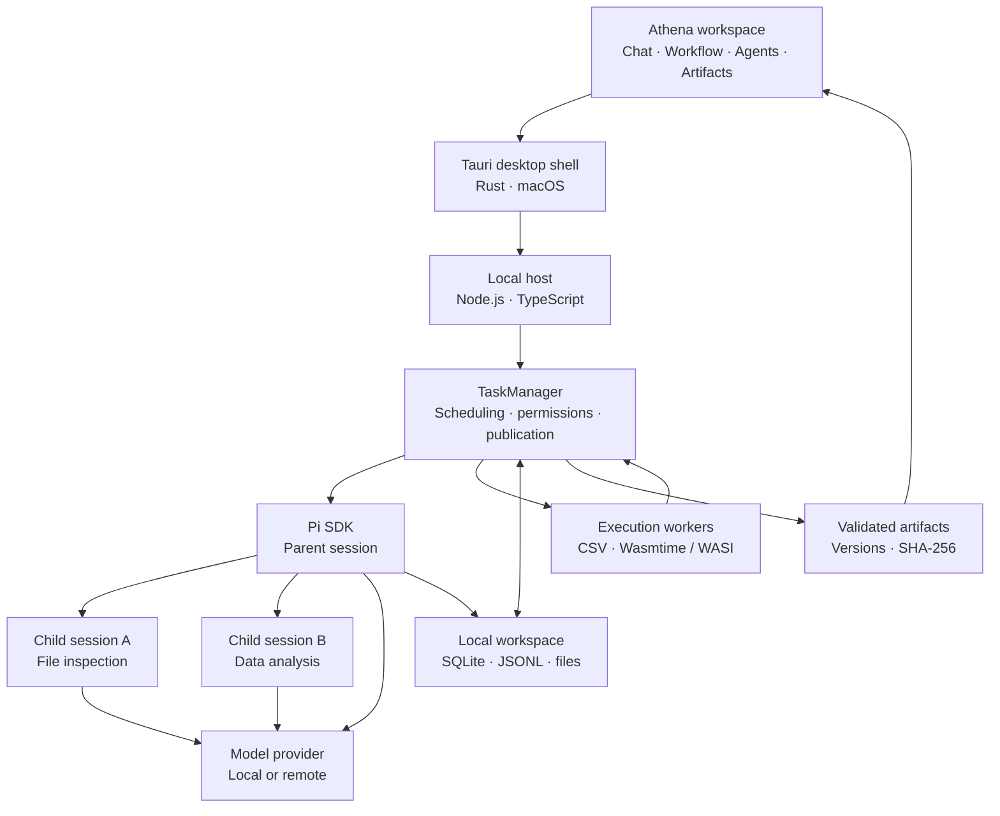

<div align="center">
  <picture>
    <source media="(prefers-color-scheme: dark)" srcset="assets/icon-dark.png">
    
  </picture>

  <h1>Athena</h1>
  <p><strong>Ein Local-first-Arbeitsbereich für KI-gestützte Forschung.</strong></p>
  <p>Mit Agenten forschen. Ihre Arbeit prüfen. Nachweise bewahren.</p>

  <a href="https://github.com/yanaire/athena/actions/workflows/verify.yml"></a>
  
  

  <p>
    <a href="README.md">English</a> · <a href="README.ko.md">한국어</a> · <a href="README.ja.md">日本語</a> · <a href="README.zh-CN.md">简体中文</a> · <a href="README.zh-TW.md">繁體中文</a> · <a href="README.es.md">Español</a> · <a href="README.fr.md">Français</a> · <strong>Deutsch</strong> · <a href="README.pt-BR.md">Português (Brasil)</a>
  </p>
</div>

> **Stand (2026-11-25):** Der geprüfte Integrationskandidat enthält den Quellcode für MCP, Forschungserweiterungen, den Workflow-DAG sowie Windows und Intel-Macs.
> Die folgende Beschreibung des bisherigen Stands und die Prüfprotokolle bewahren den Verlauf einer früheren Version; die abschließende Abnahme auf einem echten Mac mit einem realen Benutzerkonto steht noch aus, und der aktuelle Integrationsumfang ist in der [englischen README](README.md) und im [Integrationsprüfbericht](docs/validation/2026-11-25-open-pr-integration-review.md) beschrieben.

> [!IMPORTANT]
> **Quellcode-Vorschau, keine offizielle öffentliche Veröffentlichung.** Für Athena-eigenen Code wurde Apache-2.0 gewählt; Hinweise zu Drittmaterialien, Rechte an UI und Ressourcen sowie die Freigabe der Git-Historie werden jedoch weiterhin geprüft. Die öffentliche Sichtbarkeit des Repositorys erfüllt diese Pflichten nicht. Verbreiten Sie den Quellcode-Kandidaten oder die App erst weiter, wenn die offenen Freigabebedingungen erfüllt sind. Siehe [Veröffentlichungsstatus](docs/oss-preview-status.md), [Drittanbieterhinweise](THIRD_PARTY_NOTICES.md) und [bekannte Einschränkungen](docs/known-limitations.md). Es gibt kein offiziell signiertes und notarisiertes Installationspaket und kein öffentliches DMG.

## Überblick

Athena ist eine Ausführungsumgebung für KI-Agenten und ein Desktop-Arbeitsbereich für Forschung. Statt eine KI-Antwort als vollständiges Ergebnis zu behandeln, verbindet Athena Gespräche, delegierte Aufgaben, Dateiinspektion, Analysen und nachvollziehbare Ergebnisartefakte in einem lokalen Arbeitsbereich.

**Drei Gestaltungsprinzipien**

- **Orchestrierung:** Ein übergeordneter Agent delegiert unabhängige Aufgaben an untergeordnete Sitzungen und führt die Ergebnisse zusammen.
- **Nachvollziehbarkeit:** Ausführungsereignisse, Aufgabenbeziehungen, Quelldateien und validierte Artefakte lassen sich prüfen.
- **Lokale Kontrolle:** Projektdateien und Gesprächsverläufe bleiben auf dem eigenen Rechner; unterstützte lokale oder entfernte Modellanbieter sind wählbar.

Local-first bezieht sich auf Arbeitsbereich und Ausführungsumgebung, nicht auf eine Garantie, dass Inferenz oder sämtliche Datenverarbeitung offline bleiben. Entfernte Modellanbieter erhalten die für die Inferenz erforderlichen Eingaben.

## Funktionen

Die folgende Übersicht beschreibt den aktuellen Stand von `main`, nicht noch nicht zusammengeführte Funktionszweige.

| Bereich | Aktuelle Funktion |
| :--- | :--- |
| Forschungsarbeitsbereich | Projekte, Forschungsgespräche, Anhänge, Streaming-Antworten und persistenter Verlauf |
| Multi-Agenten-Ausführung | Über- und untergeordnete Pi-Sitzungen, Delegation, Parallelitäts- und Tiefengrenzen, Abbruch und Workflow-Inspektion |
| Forschungsdateien | Begrenzte Dateizugriffe, integrierte CSV-Statistik und vom Host validierte Downloads mit Eingabeversionen und SHA-256-Nachweisen |
| Offline-Analyse | Optionale Python- (CPython/WASI) und JavaScript-Ausführung (QuickJS-ng) über Wasmtime, ohne Docker |
| Modellverbindungen | Unterstützte OpenAI- und Anthropic-API-Zugangsdaten, kompatible Endpunkte, gespeicherte Modellprofile und Verbindungsprüfung |
| Desktop | Quellcode-Build für macOS Apple Silicon mit Tauri und gebündeltem Node-Hilfsprozess |
| Ausführungstransparenz | Ansichten Workflow, Agents, Execution und Artifacts auf Basis realer Host-Aufzeichnungen |

**In Entwicklung / nicht im aktuellen Basisstand:** Die MCP-Integration wird separat entwickelt. Persistente Wissensbibliotheken, versionierte PDFs, Manuskript- und Review-Workflows, erweiterte Pi-Plug-ins, Genehmigungen und automatische Wiederholungen sind nicht implementiert. Siehe [offene Vertragsanforderungen](athena-backend-handoff/CONTRACT-GAPS.md).

## Architektur



Die Entwicklungsoberfläche im Browser kann direkt mit dem lokalen Node-Host verbunden werden. TaskManager verwaltet Zeitplanung, Dateiberechtigungen, Ausführungszustand und Artefaktveröffentlichung; das offizielle Pi SDK verwaltet unabhängige über- und untergeordnete Modellsitzungen sowie deren JSONL-Verläufe. Die Modellauswahl bleibt während einer Ausführung und ihrer untergeordneten Aufgaben unverändert.

| Ebene | Technologie |
| :--- | :--- |
| Desktop | Rust · Tauri 2 · WKWebView |
| Agenten-Host | Node.js 24 · TypeScript · Pi SDK 1.5.2 |
| Persistenz | SQLite-Metadaten · JSONL-Sitzungsverlauf · Projektdateien |
| Analyse | Rust · Wasmtime · CPython/WASI · QuickJS-ng |
| UI-Transport | Lokales HTTP RPC · Server-Sent Events |
| Verifikation | GitHub Actions · TypeScript · Node- und Rust-Tests · Gitleaks |

[Architekturleitfaden](docs/architecture.md) · [Browser/Host-Schnittstelle](athena-backend-handoff/athena-codex-ui/integrations/host-wire.d.ts) · [Sandbox-Grenzen](docs/sandbox-security.md)

## Schnellstart

Diese Anleitung gilt für eine **autorisierte lokale Kopie des Quellcodes**. Die Vorschau enthält kein offizielles Installationspaket.

### 1. Browser-Entwicklung

**Voraussetzungen:** Node.js 24 (geprüfte Version: 24.22.3), npm und ein OpenAI-kompatibler Modellserver mit Streaming und Werkzeugaufrufen. Verwenden Sie den tatsächlichen Endpunkt und die Modell-ID Ihres Servers.

```sh
npm ci --ignore-scripts --no-audit --no-fund

export ATHENA_ENDPOINT=http://127.0.0.1:8080/v1
export ATHENA_MODEL=athena-local

# If required, set ATHENA_API_KEY privately in the host environment.
npm start
```

Öffnen Sie **http://127.0.0.1:4317**. Prüfen und speichern Sie die Verbindung unter **Settings → Models**. Erstellen Sie über **Add project** ein Projekt und über **New research** ein Gespräch.

Das direkte Öffnen der generierten Datei `athena-preview.html` zeigt eine eigenständige Demo, keine verbundene Forschungsumgebung. Eine OmO-Installation, Anmeldung oder Sitzung ist nicht erforderlich.

### 2. macOS-Desktop aus dem Quellcode bauen

Ziel: **Apple Silicon · macOS 13.5 oder neuer**. Installieren Sie die festgelegten Werkzeugversionen und Voraussetzungen aus dem [Entwicklungsleitfaden](docs/development.md).

```sh
npm ci --ignore-scripts --no-audit --no-fund
npm run analysis:prepare
npm run desktop:build
```

Ausgabe:

```text
src-tauri/target/aarch64-apple-darwin/release/bundle/macos/Athena.app
```

Die App enthält die Node-Laufzeit, Pi SDK und zwei Analyse-Interpreter, jedoch keine Modellgewichte oder Zugangsdaten. Der Entwicklungs-Build ist nicht mit Developer ID signiert oder notarisiert. Umgehen Sie Gatekeeper nicht, um eine erfolgreiche Installationsprüfung zu behaupten.

[Installationsdetails](docs/installation.md) · [Modellanbieter](docs/model-providers.md)

<details>
<summary><strong>Persönlicher lokaler ChatGPT-Build</strong></summary>

Die Anmeldung mit dem ChatGPT-Abonnement ist im Standard-Desktop-Build und im Browser-Host deaktiviert. Für die persönliche Nutzung auf dem Mac kann ein alternativer Entwicklungs-Build den offiziellen Anmeldeweg aktivieren.

```sh
npm run desktop:build:local-chatgpt
```

Er nutzt denselben Ausgabepfad mit einer anderen App-ID. Kopieren Sie das vorhandene App-Bundle vor dem Wechsel. OpenAI entscheidet über die Berechtigung von Konto und Arbeitsbereich; eine persönliche lokale Autorisierung bedeutet keine Genehmigung für entfernte oder kommerzielle Bereitstellung.

[Verbindungsanleitung](docs/installation.md#personal-local-build-with-chatgpt) · [Verifikationsprotokoll](docs/m42/siwc.md)

</details>

## Forschungsbeispiel

Nutzen Sie die mitgelieferten synthetischen Daten [measurements.csv](docs/measurements.csv), um den Ablauf vom Agenten zum Artefakt nachzuvollziehen.

1. Erstellen Sie ein Forschungsgespräch und hängen Sie die CSV an.
2. Bitten Sie den übergeordneten Agenten, zwei Aufgaben zu delegieren, beide zu starten und auf die Ergebnisse zu warten.
3. Prüfen Sie die untergeordneten Aufgaben in **Workflow** und laden Sie die validierte Ausgabe unter **Artifacts** herunter.

**Beispiel-Prompt**

> Delegiere zwei Aufgaben. Bitte den ersten untergeordneten Agenten, mit `read` Zeilenanzahl, fehlende Werte und Einheiten zu prüfen. Der zweite soll mit `calculate_csv` die Spalte `measurement_mV` analysieren und `statistics.json` erzeugen. Starte beide, warte auf ihre Ergebnisse und nenne den Mittelwert sowie den Link zur tatsächlichen Ergebnisdatei.

Dateizugriff und der integrierte CSV-Worker benötigen die optionale Analyse-Laufzeit nicht. Siehe [M2-Abnahme](docs/M2-ACCEPTANCE.md) und [Prozessgrenzen](docs/M2-PROCESSES.md).

## Sicherheit und Ausführungsgrenzen

Athena ist für einen einzelnen Benutzer auf einem vertrauenswürdigen Rechner vorgesehen. Der Host bindet an Loopback; stellen Sie ihn nicht über externe Schnittstellen oder gemeinsam genutzte Proxys bereit. Dem Browser-Entwicklungshost fehlt die Sitzungsschutzschicht des Desktops.

- Der Standard-Browser-Arbeitsbereich ist `~/.athena/workspace`; `ATHENA_DATA_DIR` und `ATHENA_PORT` sind konfigurierbar. Ein Neustart führt unvollendete Aufgaben nicht automatisch erneut aus.
- Lokale Gespräche, Eingaben und Artefakte werden nicht durch den Zugangsdaten-Speicher verschlüsselt. Programme unter demselben Betriebssystemkonto können darauf zugreifen.
- macOS-Zugangsdaten liegen im Klartext unter `~/Library/Application Support/Athena/auth/credentials.v2.json` mit Verzeichnisrechten `0700` und Dateirechten `0600`. Das schützt nicht vor demselben Betriebssystembenutzer, privilegierten Administratoren oder Backups.
- Der normale Start fordert keinen Keychain-Zugriff an. Über **Settings → Models → Approve import from Keychain** lässt sich ein alter Speicher optional importieren; bei Ablehnung bleibt er unverändert.
- Offline-Analyse ist je Projekt standardmäßig deaktiviert. Aktivieren Sie sie über **Settings → Agents & execution**. Python verwendet die WASI-Standardbibliothek; der ältere JavaScript-Wert `language: "node"` wählt QuickJS, nicht Node.js oder npm. Sandbox und Überwachung bieten keine vollständige Betriebssystemisolierung.

[Datenschutz](PRIVACY.md) · [Sicherheitsrichtlinie](SECURITY.md) · [Zugangsdaten-Speicher](docs/keychain-security.md) · [Analysesicherheit](docs/sandbox-security.md)

<details>
<summary><strong>Laufzeitgrenzen und Host-Schnittstelle</strong></summary>

| Umgebungsvariable | Standard | Bedeutung |
| :--- | ---: | :--- |
| `ATHENA_MODEL_CONCURRENCY` | 2 | 1–64; wartende Eltern geben Modellplätze an Kinder ab |
| `ATHENA_PROCESS_CONCURRENCY` | 1 | 1–4; eigenständige Prozessgrenze |
| `ATHENA_MAX_CHILDREN` | 8 | 0–128; direkte Kinder je übergeordneter Ausführung |
| `ATHENA_MAX_DEPTH` | 1 | 0 deaktiviert Delegation; 1 erlaubt nur direkte Kinder |

Der Browser nutzt `GET /api/bootstrap`, `POST /api/rpc` und `GET /api/events`. Modellprüfung, Konfigurationsspeicherung und erfolgreiche Generierung oder Werkzeugausführung sind getrennte Ereignisse. Browser-Speicher ist nicht die maßgebliche Quelle des Ausführungsverlaufs. TaskManager veröffentlicht Artefakte erst nach Prüfung von Eigentümerschaft, Dateibytes und Eingabeversionen.

[Schnittstellentypen](athena-backend-handoff/athena-codex-ui/integrations/host-wire.d.ts) · [M2-Prozesse](docs/M2-PROCESSES.md)

</details>

## Entwicklung und Verifikation

```sh
npm run check
npm run analysis:prepare
npm test
python3 athena-backend-handoff/athena-codex-ui/build.py
```

Der Workflow [Verify Athena](.github/workflows/verify.yml) prüft die erreichbare Git-Historie mit Gitleaks, validiert Typen und UI-Schnittstellen, testet Host und kontrollierte Anbieter, prüft produktive npm-Abhängigkeiten und deklarierte Lizenzen und baut und verifiziert die Apple-Silicon-App.

Für einen separaten Abnahmetest mit einem echten Modell konfigurieren Sie Endpunkt und Modell wie oben.

```sh
node scripts/live-acceptance.mjs
```

Der Test nutzt echte Modell-Token und einen temporären Arbeitsbereich. Er prüft Dateizugriffe, Modellausgaben, Streaming-Ereignisse, IDs und den persistenten Verlauf nach einem Neustart. Tests mit kontrollierten Anbietern ersetzen keine Abnahme mit einem echten Modell; ein erfolgreicher CI-Lauf ist keine Veröffentlichungsfreigabe.

[Entwicklungsleitfaden](docs/development.md) · [M1-Abnahme](docs/M1-ACCEPTANCE.md) · [M2-Abnahme](docs/M2-ACCEPTANCE.md)

## Repository-Struktur

```text
athena/
├── runtime/                 # Local agent host and TaskManager
├── src-tauri/               # Rust/Tauri desktop shell
├── sandbox/                 # Rust/WASI analysis helper
├── athena-backend-handoff/  # UI, integration contracts and QA
├── assets/                  # Athena icon variants
├── scripts/                 # Build and acceptance tooling
├── tests/                   # Host and provider regression tests
├── docs/                    # Architecture, security, verification
└── .github/workflows/       # CI verification
```

## Dokumentation

| Thema | Leitfaden |
| :--- | :--- |
| Einstieg | [Installation](docs/installation.md) · [Modellanbieter](docs/model-providers.md) |
| Interna | [Architektur](docs/architecture.md) · [UI-Integration](athena-backend-handoff/START-HERE.md) |
| Entwicklung | [Build und Tests](docs/development.md) · [Abnahmeanforderungen](athena-backend-handoff/ACCEPTANCE.md) |
| Sicherheit | [Datenschutz](PRIVACY.md) · [Sicherheit](SECURITY.md) · [Sandbox](docs/sandbox-security.md) |
| Veröffentlichung | [Vorschaustatus](docs/oss-preview-status.md) · [Einschränkungen](docs/known-limitations.md) · [Checkliste](docs/release-checklist.md) · [M4.2-Hinweise](docs/m42/release-notes.md) |
| Projektrichtlinien | [Mitwirkung](CONTRIBUTING.md) · [Verhaltenskodex](CODE_OF_CONDUCT.md) · [Drittanbieterhinweise](THIRD_PARTY_NOTICES.md) |

## Lizenz und Mitwirkungsstatus

Für Athena-eigenen Code wurde die [Apache License 2.0](LICENSE) gewählt. Drittmaterialien unterliegen ihren eigenen Bedingungen. Die [Weiterverbreitungsprüfung](THIRD_PARTY_NOTICES.md) und [Veröffentlichungsbedingungen](docs/oss-preview-status.md) bleiben maßgeblich; dieses README genehmigt keine weitere Verbreitung oder öffentliche Mitwirkung. Beachten Sie die [Mitwirkungsrichtlinie](CONTRIBUTING.md).

Bei Sicherheitsproblemen beachten Sie [SECURITY.md](SECURITY.md). Private Meldungen müssen aktiviert und verifiziert werden, bevor dieser Kanal verlässlich genutzt werden kann. Veröffentlichen Sie keine Schwachstellen, Token, personenbezogenen Daten oder Forschungsdateien in öffentlichen Issues.

---

<div align="center">
  <sub>ATHENA · LOCAL RESEARCH WORKSPACE</sub>
</div>
