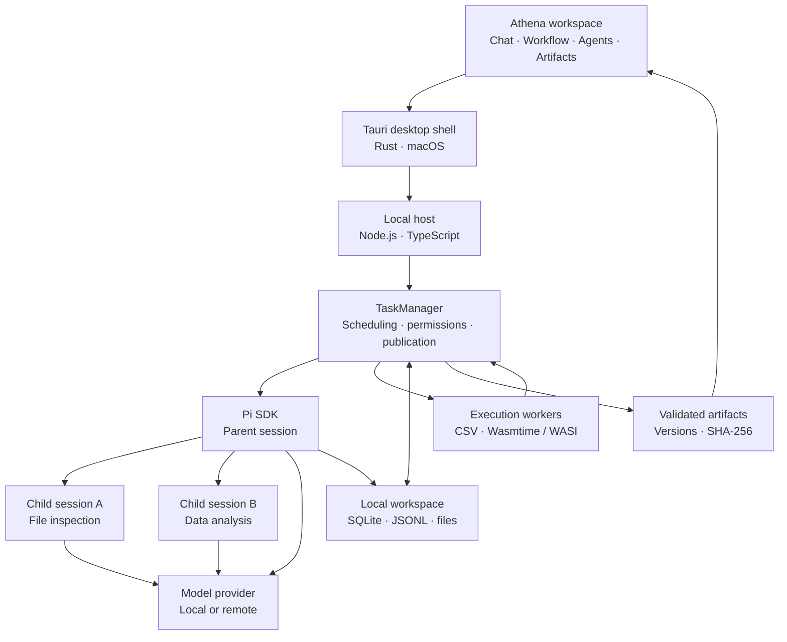

<div align="center">
  <picture>
    <source media="(prefers-color-scheme: dark)" srcset="assets/icon-dark.png">
    
  </picture>

  <h1>Athena</h1>
  <p><strong>Un espacio local-first para la investigación asistida por IA.</strong></p>
  <p>Investiga con agentes. Inspecciona su trabajo. Conserva la evidencia.</p>

  <a href="https://github.com/yanaire/athena/actions/workflows/verify.yml"></a>
  
  

  <p>
    <a href="README.md">English</a> · <a href="README.ko.md">한국어</a> · <a href="README.ja.md">日本語</a> · <a href="README.zh-CN.md">简体中文</a> · <a href="README.zh-TW.md">繁體中文</a> · <strong>Español</strong> · <a href="README.fr.md">Français</a> · <a href="README.de.md">Deutsch</a> · <a href="README.pt-BR.md">Português (Brasil)</a>
  </p>
</div>

> **Estado (2026-11-25):** El candidato de integración revisado para Mac con Apple Silicon incluye el código fuente de MCP, las extensiones de investigación y el DAG de flujos de trabajo.
> La descripción del estado base y los registros de validación que siguen conservan el historial de una versión anterior; la aceptación final en un Mac real con una cuenta real sigue pendiente, y el alcance actual de la integración se detalla en el [README en inglés](README.md) y en el [informe de revisión de la integración](docs/validation/2026-11-25-open-pr-integration-review.md).

> [!IMPORTANT]
> **Vista previa del código fuente, no una versión pública oficial.** El código propio de Athena adopta Apache-2.0, pero los avisos de terceros, los derechos de la interfaz y los recursos, y la autorización del historial Git siguen en revisión. La visibilidad pública del repositorio no resuelve estas obligaciones. No redistribuyas el código candidato ni la aplicación hasta resolverlas. Consulta el [estado de publicación](docs/oss-preview-status.md), los [avisos de terceros](THIRD_PARTY_NOTICES.md) y las [limitaciones conocidas](docs/known-limitations.md). No hay instalador oficial firmado y notarizado ni DMG público.

## Descripción general

Athena es un entorno de investigación de escritorio y un marco de ejecución de agentes de IA. No considera que una respuesta de IA sea todo el resultado: conecta conversaciones, tareas delegadas, inspección de archivos, análisis y artefactos trazables en un único espacio local.

**Tres principios de diseño**

- **Orquestación:** un agente principal delega trabajo independiente en sesiones hijas e integra los resultados.
- **Trazabilidad:** inspecciona eventos de ejecución, relaciones entre tareas, archivos de origen y artefactos validados.
- **Control local:** conserva los archivos y el historial en tu equipo y elige un proveedor de modelos local o remoto compatible.

El enfoque local-first se refiere al espacio de trabajo y al entorno de ejecución; no garantiza que la inferencia ni todo el procesamiento sean offline. Los proveedores remotos reciben las entradas necesarias para la inferencia.

## Funcionalidades

Esta tabla describe el código de `main`, no las ramas de funciones sin fusionar.

| Área | Funcionalidad actual |
| :--- | :--- |
| Espacio de investigación | Proyectos, conversaciones, adjuntos, respuestas en streaming e historial persistente |
| Ejecución multiagente | Sesiones Pi padre/hijo, delegación, límites de concurrencia y profundidad, cancelación e inspección de flujos |
| Archivos de investigación | Lectura de alcance limitado, estadísticas CSV integradas y artefactos descargables validados por el host con versiones de entrada y comprobantes SHA-256 |
| Análisis offline | Ejecución opcional de Python (CPython/WASI) y JavaScript (QuickJS-ng) mediante Wasmtime, sin Docker |
| Conexiones de modelos | Credenciales API de OpenAI y Anthropic, endpoints compatibles, perfiles guardados y verificación de conexión |
| Escritorio | Compilación desde fuentes en macOS Apple Silicon con Tauri y un proceso auxiliar Node incluido |
| Visibilidad de ejecución | Vistas Workflow, Agents, Execution y Artifacts basadas en registros reales del host |

**En desarrollo / fuera de la base actual:** la integración MCP se desarrolla por separado. La biblioteca de conocimiento persistente, los flujos de PDF versionado, manuscritos y revisión, los complementos avanzados de Pi, las aprobaciones y los reintentos automáticos aún no están implementados. Consulta las [carencias del contrato](athena-backend-handoff/CONTRACT-GAPS.md).

## Arquitectura



La interfaz de desarrollo en navegador también puede conectarse directamente al host Node local. TaskManager controla la planificación, los permisos de archivos, el estado de ejecución y la publicación de artefactos. El SDK oficial Pi gestiona las sesiones de modelo padre/hijo independientes y sus historiales JSONL. La selección de modelo permanece fija durante una ejecución y sus tareas hijas.

| Capa | Tecnología |
| :--- | :--- |
| Escritorio | Rust · Tauri 2 · WKWebView |
| Host de agentes | Node.js 24 · TypeScript · Pi SDK 1.5.2 |
| Persistencia | Metadatos SQLite · historial JSONL · archivos de proyecto |
| Análisis | Rust · Wasmtime · CPython/WASI · QuickJS-ng |
| Transporte UI | RPC HTTP local · Server-Sent Events |
| Verificación | GitHub Actions · TypeScript · pruebas Node y Rust · Gitleaks |

[Guía de arquitectura](docs/architecture.md) · [Contrato navegador/host](athena-backend-handoff/athena-codex-ui/integrations/host-wire.d.ts) · [Límites del sandbox](docs/sandbox-security.md)

## Inicio rápido

Estas instrucciones son para una **copia local autorizada del código fuente**. La vista previa no incluye instalador oficial.

### 1. Desarrollo en navegador

**Requisitos:** Node.js 24 (versión verificada: 24.22.3), npm y un servidor de modelos compatible con OpenAI que admita streaming y llamadas a herramientas. Usa el endpoint y el identificador reales del modelo.

```sh
npm ci --ignore-scripts --no-audit --no-fund

export ATHENA_ENDPOINT=http://127.0.0.1:8080/v1
export ATHENA_MODEL=athena-local

# If required, set ATHENA_API_KEY privately in the host environment.
npm start
```

Abre **http://127.0.0.1:4317**. Verifica y guarda la conexión en **Settings → Models**. Crea un proyecto con **Add project** y una conversación con **New research**.

Abrir directamente el archivo generado `athena-preview.html` muestra una demo independiente, no un entorno de investigación conectado. No se requiere instalación, inicio de sesión ni sesión de OmO.

### 2. Compilación de escritorio para macOS

Destino: **Apple Silicon · macOS 13.5 o posterior**. Instala las versiones fijadas y los requisitos de la [guía de desarrollo](docs/development.md).

```sh
npm ci --ignore-scripts --no-audit --no-fund
npm run analysis:prepare
npm run desktop:build
```

Salida:

```text
src-tauri/target/aarch64-apple-darwin/release/bundle/macos/Athena.app
```

La aplicación incluye el runtime Node, Pi SDK y dos intérpretes de análisis, pero no los pesos del modelo ni las credenciales. Esta compilación de desarrollo no está firmada con Developer ID ni notarizada. No eludas Gatekeeper para dar por válida la instalación.

[Detalles de instalación](docs/installation.md) · [Proveedores de modelos](docs/model-providers.md)

<details>
<summary><strong>Compilación personal local con ChatGPT</strong></summary>

El acceso con el plan ChatGPT está desactivado en la compilación estándar de escritorio y en el host del navegador. Una compilación alternativa permite habilitar la vía oficial de acceso para uso personal en Mac.

```sh
npm run desktop:build:local-chatgpt
```

Usa la misma ruta de salida con otro identificador de aplicación. Copia el paquete existente antes de cambiar de compilación. OpenAI determina la elegibilidad de la cuenta y del espacio de trabajo; la autorización de uso personal local no supone aprobación para un despliegue remoto o comercial.

[Instrucciones de conexión](docs/installation.md#personal-local-build-with-chatgpt) · [Registro de verificación](docs/m42/siwc.md)

</details>

## Ejemplo de investigación

Utiliza los datos sintéticos incluidos en [measurements.csv](docs/measurements.csv) para seguir el flujo desde los agentes hasta el artefacto.

1. Crea una conversación de investigación y adjunta el CSV.
2. Pide al agente principal que delegue dos tareas, inicie ambas y espere los resultados.
3. Inspecciona las tareas hijas en **Workflow** y descarga la salida validada en **Artifacts**.

**Ejemplo de prompt**

> Delega dos tareas. Pide a la primera sesión hija que use `read` para comprobar las filas, los valores ausentes y las unidades. Pide a la segunda que use `calculate_csv` sobre `measurement_mV` y genere `statistics.json`. Inicia ambas, espera los resultados e informa de la media y del enlace al archivo real.

La lectura de archivos y el trabajador CSV integrado no necesitan el runtime de análisis opcional. Consulta la [aceptación M2](docs/M2-ACCEPTANCE.md) y los [límites de procesos](docs/M2-PROCESSES.md).

## Seguridad y límites de ejecución

Athena está pensado para un único usuario en un equipo de confianza. El host escucha en loopback; no lo expongas mediante interfaces externas ni proxies compartidos. El host de desarrollo en navegador carece de la protección de sesión del escritorio.

- El espacio del navegador por defecto es `~/.athena/workspace`; `ATHENA_DATA_DIR` y `ATHENA_PORT` se pueden configurar. El reinicio no vuelve a ejecutar automáticamente tareas pendientes.
- Las conversaciones, entradas y artefactos locales no se cifran mediante el almacén de credenciales. Los programas que se ejecuten como el mismo usuario del SO pueden acceder a ellos.
- Las credenciales de macOS se guardan en texto plano en `~/Library/Application Support/Athena/auth/credentials.v2.json`, con permisos de directorio `0700` y archivo `0600`. No protegen contra el mismo usuario, administradores privilegiados ni copias de seguridad.
- El inicio normal no solicita acceso a Keychain. **Settings → Models → Approve import from Keychain** permite importar opcionalmente el almacén anterior; si se rechaza, este queda intacto.
- El análisis offline está desactivado por defecto en cada proyecto. Actívalo en **Settings → Agents & execution**. Python usa la biblioteca estándar WASI; el valor antiguo de JavaScript `language: "node"` selecciona QuickJS, no Node.js ni npm. El sandbox y el monitor no constituyen un aislamiento completo del SO.

[Privacidad](PRIVACY.md) · [Política de seguridad](SECURITY.md) · [Almacenamiento de credenciales](docs/keychain-security.md) · [Seguridad del análisis](docs/sandbox-security.md)

<details>
<summary><strong>Límites de ejecución y contrato del host</strong></summary>

| Variable de entorno | Valor inicial | Significado |
| :--- | ---: | :--- |
| `ATHENA_MODEL_CONCURRENCY` | 2 | 1–64; los padres en espera ceden plazas de modelo a sus hijos |
| `ATHENA_PROCESS_CONCURRENCY` | 1 | 1–4; límite independiente de procesos |
| `ATHENA_MAX_CHILDREN` | 8 | 0–128; hijos directos por ejecución del padre |
| `ATHENA_MAX_DEPTH` | 1 | 0 desactiva la delegación; 1 solo permite hijos directos |

El navegador usa `GET /api/bootstrap`, `POST /api/rpc` y `GET /api/events`. Verificar el modelo, guardar la configuración y completar una generación o una llamada a herramientas son eventos distintos. El almacenamiento del navegador no es la fuente de verdad del historial. TaskManager solo publica artefactos tras validar propiedad, bytes y versiones de entrada.

[Tipos de comunicación](athena-backend-handoff/athena-codex-ui/integrations/host-wire.d.ts) · [Procesos M2](docs/M2-PROCESSES.md)

</details>

## Desarrollo y verificación

```sh
npm run check
npm run analysis:prepare
npm test
python3 athena-backend-handoff/athena-codex-ui/build.py
```

El [flujo Verify Athena](.github/workflows/verify.yml) analiza el historial Git alcanzable con Gitleaks, valida tipos y contratos de UI, prueba el host y proveedores controlados, audita las dependencias npm de producción y sus licencias declaradas, y compila y verifica la aplicación Apple Silicon.

Para una prueba de aceptación separada con un modelo real, configura el endpoint y el modelo anteriores:

```sh
node scripts/live-acceptance.mjs
```

Usa tokens reales y un espacio temporal. Comprueba lecturas de archivos, resultados del modelo, eventos de streaming, IDs e historial persistente tras el reinicio. Las pruebas con proveedores controlados no sustituyen la aceptación con modelos reales; un CI exitoso no equivale a una autorización de publicación.

[Guía de desarrollo](docs/development.md) · [Aceptación M1](docs/M1-ACCEPTANCE.md) · [Aceptación M2](docs/M2-ACCEPTANCE.md)

## Estructura del repositorio

```text
athena/
├── runtime/                 # Local agent host and TaskManager
├── src-tauri/               # Rust/Tauri desktop shell
├── sandbox/                 # Rust/WASI analysis helper
├── athena-backend-handoff/  # UI, integration contracts and QA
├── assets/                  # Athena icon variants
├── scripts/                 # Build and acceptance tooling
├── tests/                   # Host and provider regression tests
├── docs/                    # Architecture, security, verification
└── .github/workflows/       # CI verification
```

## Documentación

| Tema | Guía |
| :--- | :--- |
| Primeros pasos | [Instalación](docs/installation.md) · [Proveedores](docs/model-providers.md) |
| Arquitectura interna | [Arquitectura](docs/architecture.md) · [Integración UI](athena-backend-handoff/START-HERE.md) |
| Desarrollo | [Compilación y pruebas](docs/development.md) · [Contrato de aceptación](athena-backend-handoff/ACCEPTANCE.md) |
| Seguridad | [Privacidad](PRIVACY.md) · [Seguridad](SECURITY.md) · [Sandbox](docs/sandbox-security.md) |
| Publicación | [Estado](docs/oss-preview-status.md) · [Limitaciones](docs/known-limitations.md) · [Lista de comprobación](docs/release-checklist.md) · [Notas M4.2](docs/m42/release-notes.md) |
| Políticas | [Contribución](CONTRIBUTING.md) · [Código de conducta](CODE_OF_CONDUCT.md) · [Avisos de terceros](THIRD_PARTY_NOTICES.md) |

## Licencia y contribuciones

La licencia seleccionada para el código propio de Athena es [Apache License 2.0](LICENSE). Los materiales de terceros conservan sus condiciones. Siguen vigentes la [revisión de redistribución](THIRD_PARTY_NOTICES.md) y las [condiciones de publicación](docs/oss-preview-status.md); este README no autoriza ampliar la distribución ni abrir contribuciones. Sigue la [política de contribución](CONTRIBUTING.md).

Para cuestiones de seguridad, sigue [SECURITY.md](SECURITY.md). El canal privado de notificación debe habilitarse y verificarse antes de confiar en él. No publiques vulnerabilidades, tokens, datos personales ni archivos de investigación en incidencias públicas.

---

<div align="center">
  <sub>ATHENA · LOCAL RESEARCH WORKSPACE</sub>
</div>
