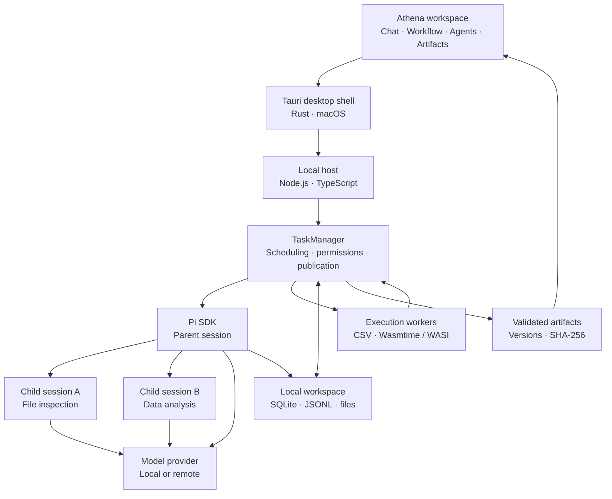

<div align="center">
  <picture>
    <source media="(prefers-color-scheme: dark)" srcset="assets/icon-dark.png">
    
  </picture>

  <h1>Athena</h1>
  <p><strong>Un espace de travail local-first pour la recherche assistée par IA.</strong></p>
  <p>Recherchez avec des agents. Inspectez leur travail. Conservez les preuves.</p>

  <a href="https://github.com/yanaire/athena/actions/workflows/verify.yml"></a>
  
  

  <p>
    <a href="README.md">English</a> · <a href="README.ko.md">한국어</a> · <a href="README.ja.md">日本語</a> · <a href="README.zh-CN.md">简体中文</a> · <a href="README.zh-TW.md">繁體中文</a> · <a href="README.es.md">Español</a> · <strong>Français</strong> · <a href="README.de.md">Deutsch</a> · <a href="README.pt-BR.md">Português (Brasil)</a>
  </p>
</div>

> [!IMPORTANT]
> **Aperçu du code source, pas une version publique officielle.** Le code propre à Athena est placé sous Apache-2.0, mais les mentions de tiers, les droits relatifs à l’interface et aux ressources ainsi que l’autorisation de publier l’historique Git restent à examiner. La visibilité publique du dépôt ne règle pas ces obligations. Ne redistribuez ni le code candidat ni l’application tant que les conditions restantes ne sont pas satisfaites. Consultez l’[état de publication](docs/oss-preview-status.md), les [mentions de tiers](THIRD_PARTY_NOTICES.md) et les [limites connues](docs/known-limitations.md). Aucun installateur officiel signé et notarié ni DMG public n’est disponible.

## Présentation

Athena est un cadre d’exécution d’agents IA et un espace de travail de bureau destiné à la recherche. Plutôt que de considérer la réponse de l’IA comme le seul résultat, il relie conversations, tâches déléguées, inspection de fichiers, analyses et artefacts traçables dans un environnement local.

**Trois principes de conception**

- **Orchestration :** un agent parent délègue des tâches indépendantes à des sessions enfants et combine les résultats.
- **Traçabilité :** inspecter les événements d’exécution, les relations entre tâches, les fichiers sources et les artefacts validés.
- **Contrôle local :** conserver les fichiers de projet et l’historique des conversations sur son ordinateur, en choisissant un fournisseur de modèles local ou distant compatible.

Local-first concerne l’espace de travail et l’environnement d’exécution ; cela ne garantit pas une inférence ni un traitement entièrement hors ligne. Les fournisseurs distants reçoivent les entrées nécessaires à l’inférence.

## Fonctionnalités

Le tableau décrit la version actuelle de `main`, pas les branches fonctionnelles non fusionnées.

| Domaine | Fonctionnalité actuelle |
| :--- | :--- |
| Espace de recherche | Projets, conversations, pièces jointes, réponses en streaming et historique persistant |
| Exécution multi-agents | Sessions Pi parent/enfant, délégation, limites de concurrence et de profondeur, annulation, inspection des flux |
| Fichiers de recherche | Lecture à périmètre limité, statistiques CSV intégrées, artefacts téléchargeables validés par l’hôte avec versions d’entrée et preuves SHA-256 |
| Analyse hors ligne | Exécution facultative de Python (CPython/WASI) et JavaScript (QuickJS-ng) via Wasmtime, sans Docker |
| Connexions aux modèles | Identifiants API OpenAI et Anthropic, endpoints compatibles, profils sauvegardés et vérification de connexion |
| Bureau | Compilation depuis les sources sur macOS Apple Silicon avec Tauri et un processus auxiliaire Node intégré |
| Visibilité de l’exécution | Vues Workflow, Agents, Execution et Artifacts fondées sur les enregistrements réels de l’hôte |

**En développement / hors du périmètre actuel :** l’intégration MCP est développée séparément. La bibliothèque de connaissances persistante, les flux de PDF versionnés, de manuscrits et de relecture, les extensions Pi avancées, les approbations et les nouvelles tentatives automatiques ne sont pas implémentés. Voir les [écarts du contrat](athena-backend-handoff/CONTRACT-GAPS.md).

## Architecture



L’interface de développement dans le navigateur peut aussi se connecter directement à l’hôte Node local. TaskManager gère la planification, les droits d’accès aux fichiers, l’état d’exécution et la publication des artefacts ; le SDK Pi officiel gère les sessions de modèles parent/enfant indépendantes et leurs historiques JSONL. Le choix du modèle reste fixe pour une exécution et ses tâches enfants.

| Couche | Technologie |
| :--- | :--- |
| Bureau | Rust · Tauri 2 · WKWebView |
| Hôte d’agents | Node.js 24 · TypeScript · Pi SDK 1.5.2 |
| Persistance | Métadonnées SQLite · historique JSONL · fichiers de projet |
| Analyse | Rust · Wasmtime · CPython/WASI · QuickJS-ng |
| Transport UI | RPC HTTP local · Server-Sent Events |
| Vérification | GitHub Actions · TypeScript · tests Node et Rust · Gitleaks |

[Guide d’architecture](docs/architecture.md) · [Contrat navigateur/hôte](athena-backend-handoff/athena-codex-ui/integrations/host-wire.d.ts) · [Limites du bac à sable](docs/sandbox-security.md)

## Démarrage rapide

Ces instructions concernent une **copie locale autorisée du code source**. Aucun installateur officiel n’est fourni dans cet aperçu.

### 1. Développement dans le navigateur

**Prérequis :** Node.js 24 (version vérifiée : 24.22.3), npm et un serveur de modèles compatible OpenAI prenant en charge le streaming et les appels d’outils. Utilisez l’endpoint et l’identifiant réels du modèle.

```sh
npm ci --ignore-scripts --no-audit --no-fund

export ATHENA_ENDPOINT=http://127.0.0.1:8080/v1
export ATHENA_MODEL=athena-local

# If required, set ATHENA_API_KEY privately in the host environment.
npm start
```

Ouvrez **http://127.0.0.1:4317**. Vérifiez puis enregistrez la connexion dans **Settings → Models**. Créez un projet avec **Add project**, puis une conversation avec **New research**.

Ouvrir directement le fichier généré `athena-preview.html` lance une démonstration autonome, pas un environnement de recherche connecté. Aucune installation, connexion ou session OmO n’est requise.

### 2. Compilation de bureau pour macOS

Cible : **Apple Silicon · macOS 13.5 ou ultérieur**. Installez les versions fixées des outils et les prérequis du [guide de développement](docs/development.md).

```sh
npm ci --ignore-scripts --no-audit --no-fund
npm run analysis:prepare
npm run desktop:build
```

Sortie :

```text
src-tauri/target/aarch64-apple-darwin/release/bundle/macos/Athena.app
```

L’application contient le runtime Node, le SDK Pi et deux interpréteurs d’analyse, mais ni les poids des modèles ni les identifiants. Cette version de développement n’est ni signée avec Developer ID ni notariée. Ne contournez pas Gatekeeper pour prétendre que l’installation a été validée.

[Détails d’installation](docs/installation.md) · [Fournisseurs de modèles](docs/model-providers.md)

<details>
<summary><strong>Compilation locale personnelle avec ChatGPT</strong></summary>

La connexion via un abonnement ChatGPT est désactivée dans la version de bureau standard et l’hôte navigateur. Pour un usage personnel sur Mac, une compilation alternative permet d’activer la procédure de connexion officielle.

```sh
npm run desktop:build:local-chatgpt
```

Elle utilise le même chemin de sortie, avec un identifiant d’application différent. Copiez le paquet existant avant de changer de version. OpenAI détermine l’éligibilité du compte et de l’espace de travail ; une autorisation personnelle locale n’implique pas l’approbation d’un déploiement distant ou commercial.

[Instructions de connexion](docs/installation.md#personal-local-build-with-chatgpt) · [Journal de vérification](docs/m42/siwc.md)

</details>

## Exemple de recherche

Utilisez les données synthétiques fournies dans [measurements.csv](docs/measurements.csv) pour suivre le processus des agents aux artefacts.

1. Créez une conversation de recherche et joignez le CSV.
2. Demandez à l’agent parent de déléguer deux tâches, de les lancer et d’attendre leurs résultats.
3. Inspectez les tâches enfants dans **Workflow**, puis téléchargez la sortie validée dans **Artifacts**.

**Exemple de prompt**

> Délègue deux tâches. Demande au premier enfant d’utiliser `read` pour vérifier le nombre de lignes, les valeurs manquantes et les unités. Demande au second d’utiliser `calculate_csv` sur `measurement_mV` et de produire `statistics.json`. Lance les deux, attends leurs résultats, puis indique la moyenne et le lien vers le véritable fichier de résultat.

La lecture de fichiers et le worker CSV intégré ne nécessitent pas le runtime d’analyse facultatif. Consultez la [validation M2](docs/M2-ACCEPTANCE.md) et les [limites des processus](docs/M2-PROCESSES.md).

## Sécurité et périmètre d’exécution

Athena est prévu pour un seul utilisateur sur une machine de confiance. L’hôte écoute sur l’interface de bouclage ; ne l’exposez pas via une interface externe ou un proxy partagé. L’hôte de développement navigateur ne bénéficie pas du contrôle de session du bureau.

- L’espace navigateur par défaut est `~/.athena/workspace` ; `ATHENA_DATA_DIR` et `ATHENA_PORT` sont configurables. Un redémarrage ne relance pas automatiquement les tâches inachevées.
- Les conversations, entrées et artefacts locaux ne sont pas chiffrés par le stockage des identifiants. Les programmes exécutés sous le même utilisateur du système peuvent y accéder.
- Sous macOS, les identifiants sont stockés en clair dans `~/Library/Application Support/Athena/auth/credentials.v2.json`, avec les permissions `0700` pour le dossier et `0600` pour le fichier. Elles ne protègent pas contre le même utilisateur, les administrateurs privilégiés ou les sauvegardes.
- Le démarrage normal ne demande pas l’accès au Trousseau. **Settings → Models → Approve import from Keychain** permet d’importer l’ancien stockage ; en cas de refus, il reste intact.
- L’analyse hors ligne est désactivée par défaut pour chaque projet. Activez-la dans **Settings → Agents & execution**. Python utilise la bibliothèque standard WASI ; l’ancienne valeur JavaScript `language: "node"` sélectionne QuickJS, et non Node.js ou npm. Le bac à sable et son dispositif de surveillance ne constituent pas une isolation complète du système.

[Confidentialité](PRIVACY.md) · [Politique de sécurité](SECURITY.md) · [Stockage des identifiants](docs/keychain-security.md) · [Sécurité de l’analyse](docs/sandbox-security.md)

<details>
<summary><strong>Limites d’exécution et contrat de l’hôte</strong></summary>

| Variable d’environnement | Défaut | Signification |
| :--- | ---: | :--- |
| `ATHENA_MODEL_CONCURRENCY` | 2 | 1–64 ; les parents en attente libèrent des créneaux de modèle pour les enfants |
| `ATHENA_PROCESS_CONCURRENCY` | 1 | 1–4 ; limite de processus indépendante |
| `ATHENA_MAX_CHILDREN` | 8 | 0–128 ; enfants directs par exécution du parent |
| `ATHENA_MAX_DEPTH` | 1 | 0 désactive la délégation ; 1 permet uniquement les enfants directs |

Le navigateur utilise `GET /api/bootstrap`, `POST /api/rpc` et `GET /api/events`. La vérification du modèle, la sauvegarde des paramètres et le succès de la génération ou des appels d’outils sont des événements distincts. Le stockage du navigateur n’est pas la source de référence de l’historique. TaskManager ne publie les artefacts qu’après validation de la propriété, des octets et des versions d’entrée.

[Types de communication](athena-backend-handoff/athena-codex-ui/integrations/host-wire.d.ts) · [Processus M2](docs/M2-PROCESSES.md)

</details>

## Développement et vérification

```sh
npm run check
npm run analysis:prepare
npm test
python3 athena-backend-handoff/athena-codex-ui/build.py
```

[Verify Athena](.github/workflows/verify.yml) analyse l’historique Git accessible avec Gitleaks, valide les types et contrats UI, exécute des tests de l’hôte et des fournisseurs contrôlés, audite les dépendances npm de production et leurs licences déclarées, puis compile et vérifie l’application Apple Silicon.

Pour un test d’acceptation distinct avec un modèle réel, configurez l’endpoint et le modèle ci-dessus :

```sh
node scripts/live-acceptance.mjs
```

Le test utilise de véritables tokens de modèle et un espace temporaire. Il vérifie les lectures de fichiers, les sorties du modèle, les événements de streaming, les identifiants et l’historique persistant après redémarrage. Les tests avec fournisseurs contrôlés ne remplacent pas l’acceptation avec un modèle réel ; le succès de la CI ne vaut pas autorisation de publication.

[Guide de développement](docs/development.md) · [Validation M1](docs/M1-ACCEPTANCE.md) · [Validation M2](docs/M2-ACCEPTANCE.md)

## Structure du dépôt

```text
athena/
├── runtime/                 # Local agent host and TaskManager
├── src-tauri/               # Rust/Tauri desktop shell
├── sandbox/                 # Rust/WASI analysis helper
├── athena-backend-handoff/  # UI, integration contracts and QA
├── assets/                  # Athena icon variants
├── scripts/                 # Build and acceptance tooling
├── tests/                   # Host and provider regression tests
├── docs/                    # Architecture, security, verification
└── .github/workflows/       # CI verification
```

## Documentation

| Sujet | Guide |
| :--- | :--- |
| Premiers pas | [Installation](docs/installation.md) · [Fournisseurs de modèles](docs/model-providers.md) |
| Fonctionnement interne | [Architecture](docs/architecture.md) · [Intégration UI](athena-backend-handoff/START-HERE.md) |
| Développement | [Compilation et tests](docs/development.md) · [Contrat d’acceptation](athena-backend-handoff/ACCEPTANCE.md) |
| Sécurité | [Confidentialité](PRIVACY.md) · [Sécurité](SECURITY.md) · [Bac à sable](docs/sandbox-security.md) |
| Publication | [État de l’aperçu](docs/oss-preview-status.md) · [Limites](docs/known-limitations.md) · [Liste de contrôle](docs/release-checklist.md) · [Notes M4.2](docs/m42/release-notes.md) |
| Politiques | [Contribution](CONTRIBUTING.md) · [Code de conduite](CODE_OF_CONDUCT.md) · [Mentions de tiers](THIRD_PARTY_NOTICES.md) |

## Licence et état des contributions

La licence choisie pour le code propre à Athena est [Apache License 2.0](LICENSE). Les éléments de tiers conservent leurs propres conditions. L’[examen de redistribution](THIRD_PARTY_NOTICES.md) et les [conditions de publication](docs/oss-preview-status.md) restent applicables ; ce README n’autorise ni une diffusion plus large ni l’ouverture des contributions. Respectez la [politique de contribution](CONTRIBUTING.md).

Pour les problèmes de sécurité, suivez [SECURITY.md](SECURITY.md). Le signalement privé doit être activé et vérifié avant de pouvoir être utilisé comme canal fiable. Ne publiez pas de vulnérabilités, tokens, données personnelles ou fichiers de recherche dans les tickets publics.

---

<div align="center">
  <sub>ATHENA · LOCAL RESEARCH WORKSPACE</sub>
</div>
