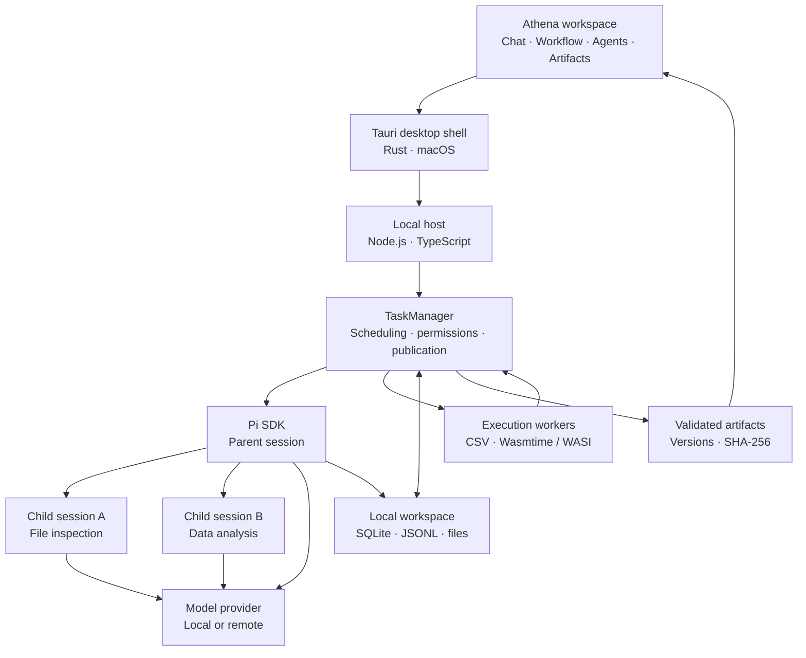

<div align="center">
  <picture>
    <source media="(prefers-color-scheme: dark)" srcset="assets/icon-dark.png">
    
  </picture>

  <h1>Athena</h1>
  <p><strong>AI を活用した研究のためのローカルファーストワークスペース。</strong></p>
  <p>エージェントで研究し、実行を確認し、証拠を残す。</p>

  <a href="https://github.com/yanaire/athena/actions/workflows/verify.yml"></a>
  
  

  <p>
    <a href="README.md">English</a> · <a href="README.ko.md">한국어</a> · <strong>日本語</strong> · <a href="README.zh-CN.md">简体中文</a> · <a href="README.zh-TW.md">繁體中文</a> · <a href="README.es.md">Español</a> · <a href="README.fr.md">Français</a> · <a href="README.de.md">Deutsch</a> · <a href="README.pt-BR.md">Português (Brasil)</a>
  </p>
</div>

> [!IMPORTANT]
> **ソースプレビューであり、正式公開リリースではありません。** Athena 自身のコードには Apache-2.0 を選択していますが、第三者のライセンス表示、UI・アセットの権利、Git 履歴の公開可否は審査中です。リポジトリが公開されていても、これらの義務は解消されません。未解決の条件を満たすまで、候補ソースやアプリを再配布しないでください。[リリース状況](docs/oss-preview-status.md)、[第三者の通知](THIRD_PARTY_NOTICES.md)、[既知の制限](docs/known-limitations.md)を参照してください。正式に署名・公証されたインストーラーや公開 DMG はありません。

## 概要

Athena は研究向け AI エージェントハーネス兼デスクトップワークスペースです。AI の回答だけを成果とせず、対話、委任タスク、ファイル確認、分析、追跡可能な成果物を一つのローカル環境で結び付けます。

**3 つの設計原則**

- **オーケストレーション:** 親エージェントが独立した作業を子セッションに委任し、結果を統合します。
- **追跡可能性:** 実行イベント、タスクの関係、入力ファイル、検証済み成果物を確認できます。
- **ローカル制御:** プロジェクトファイルと対話履歴を手元のコンピューターに保存し、対応するローカルまたはリモートモデルを選択できます。

ローカルファーストとはワークスペースと実行環境を指し、推論やすべてのデータ処理がオフラインで完結する保証ではありません。リモートモデルの提供元には推論に必要な入力が送られます。

## 主な機能

未マージの機能ブランチではなく、現在の `main` の機能を示します。

| 領域 | 現在の機能 |
| :--- | :--- |
| 研究ワークスペース | プロジェクト、研究対話、添付、ストリーミング応答、履歴の保存 |
| マルチエージェント | 親子 Pi セッション、タスク委任、並行数・深さの制限、キャンセル、ワークフロー確認 |
| 研究ファイル | 範囲を限定したファイル読み取り、組み込み CSV 統計、入力バージョンと SHA-256 証跡を伴う検証済み成果物のダウンロード |
| オフライン分析 | Docker 不要の Wasmtime による任意の Python (CPython/WASI)・JavaScript (QuickJS-ng) 実行 |
| モデル接続 | OpenAI・Anthropic API 認証情報、互換エンドポイント、モデルプロファイルの保存と接続検証 |
| デスクトップ | Tauri と同梱 Node サイドカーによる Apple Silicon macOS ソースビルド |
| 実行の可視化 | 実際のホスト記録に基づく Workflow、Agents、Execution、Artifacts |

**開発中 / 現行ベースライン対象外:** MCP 統合は別途開発中です。永続的な知識ライブラリ、バージョン付き PDF・原稿・レビューのワークフロー、高度な Pi プラグイン、承認、自動再試行は未実装です。[契約上の未実装機能](athena-backend-handoff/CONTRACT-GAPS.md)を参照してください。

## アーキテクチャ



ブラウザー開発用 UI もローカル Node ホストに直接接続できます。TaskManager はスケジューリング、ファイル権限、実行状態、成果物の公開を管理し、公式 Pi SDK は独立した親子モデルセッションと JSONL 履歴を管理します。モデル選択は一つの実行とその子タスクで固定されます。

| レイヤー | 技術 |
| :--- | :--- |
| デスクトップ | Rust · Tauri 2 · WKWebView |
| エージェントホスト | Node.js 24 · TypeScript · Pi SDK 1.5.2 |
| 永続化 | SQLite メタデータ · JSONL セッション履歴 · プロジェクトファイル |
| 分析 | Rust · Wasmtime · CPython/WASI · QuickJS-ng |
| UI 通信 | ローカル HTTP RPC · Server-Sent Events |
| 検証 | GitHub Actions · TypeScript · Node テストランナー · Rust テスト · Gitleaks |

[アーキテクチャ](docs/architecture.md) · [通信仕様](athena-backend-handoff/athena-codex-ui/integrations/host-wire.d.ts) · [サンドボックスの境界](docs/sandbox-security.md)

## クイックスタート

**使用許可のあるローカルソースのチェックアウト**を対象とします。このプレビューに正式インストーラーはありません。

### 1. ブラウザーでの開発

**要件:** Node.js 24（検証済み 24.22.3）、npm、ストリーミングとツール呼び出しに対応する OpenAI 互換モデルサーバー。実際のエンドポイントとモデル ID を設定してください。

```sh
npm ci --ignore-scripts --no-audit --no-fund

export ATHENA_ENDPOINT=http://127.0.0.1:8080/v1
export ATHENA_MODEL=athena-local

# If required, set ATHENA_API_KEY privately in the host environment.
npm start
```

**http://127.0.0.1:4317** を開き、**Settings → Models** で接続を検証して保存します。**Add project** でプロジェクトを作成し、**New research** で対話を開始します。

生成された `athena-preview.html` を直接開くと単独デモになり、接続済み研究ランタイムではありません。OmO のインストール、ログイン、セッションは不要です。

### 2. macOS デスクトップのソースビルド

対象: **Apple Silicon · macOS 13.5 以降**。[開発ガイド](docs/development.md) に記載の固定ツールチェーンと前提条件を準備してください。

```sh
npm ci --ignore-scripts --no-audit --no-fund
npm run analysis:prepare
npm run desktop:build
```

出力:

```text
src-tauri/target/aarch64-apple-darwin/release/bundle/macos/Athena.app
```

Node ランタイム、Pi SDK、2 種類の分析インタープリターを同梱しますが、モデルの重みや認証情報は含みません。この開発ビルドは Developer ID による署名・公証を受けていません。インストール検証のために Gatekeeper を回避しないでください。

[インストール詳細](docs/installation.md) · [モデル提供元](docs/model-providers.md)

<details>
<summary><strong>個人用ローカル ChatGPT ビルド</strong></summary>

標準デスクトップビルドとブラウザーホストでは ChatGPT プランのサインインが無効です。Mac での個人利用向けに、別の開発ビルドで公式サインイン経路を有効にできます。

```sh
npm run desktop:build:local-chatgpt
```

同じ出力先に別のアプリ識別子を使用するため、切り替える前に既存のバンドルをコピーしてください。アカウントとワークスペースの利用資格は OpenAI が判断します。個人ローカル利用の認可はリモート・商用配備の承認を意味しません。

[接続手順](docs/installation.md#personal-local-build-with-chatgpt) · [検証記録](docs/m42/siwc.md)

</details>

## 研究の例

同梱の合成データ [measurements.csv](docs/measurements.csv) でエージェントから成果物までの流れを確認できます。

1. 研究対話を作成し、CSV を添付します。
2. 親に二つのタスクを委任し、両方を開始して結果を待つよう依頼します。
3. **Workflow** で子タスクを確認し、**Artifacts** から検証済み出力をダウンロードします。

**プロンプト例**

> 二つのタスクを委任してください。最初の子は `read` で行数、欠損値、単位を確認し、二番目の子は `calculate_csv` で `measurement_mV` を集計して `statistics.json` を生成してください。両方を開始して結果を待ち、平均値と実際の結果ファイルへのリンクを報告してください。

ファイル読み取りと組み込み CSV ワーカーには任意の分析ランタイムは不要です。[M2 受入検証](docs/M2-ACCEPTANCE.md) · [プロセス制限](docs/M2-PROCESSES.md)

## セキュリティと実行境界

信頼できるマシンで一人のユーザーが使用することを想定しています。ホストはループバックにバインドされます。外部インターフェースや共有プロキシに公開しないでください。ブラウザー開発ホストにはデスクトップのセッション認証境界がありません。

- ブラウザーの既定ワークスペースは `~/.athena/workspace` です。`ATHENA_DATA_DIR` と `ATHENA_PORT` を変更できます。再起動で未完了タスクは自動再実行されません。
- ローカル対話、入力、成果物は認証情報ストアによって暗号化されません。同じ OS ユーザーで動くプログラムからアクセスできます。
- macOS の認証情報は `~/Library/Application Support/Athena/auth/credentials.v2.json` に平文で保存され、ディレクトリは `0700`、ファイルは `0600` です。同一 OS ユーザー、管理者、バックアップからは保護されません。
- 通常起動では Keychain アクセスを要求しません。**Settings → Models → Approve import from Keychain** で旧ストアを任意にインポートできます。拒否しても旧ストアは保持されます。
- オフライン分析はプロジェクトごとに既定で無効です。**Settings → Agents & execution** で有効にします。Python は WASI 標準ライブラリを使用し、JavaScript の旧 `language: "node"` は Node.js や npm ではなく QuickJS を指します。サンドボックスと監視機構は完全な OS 隔離ではありません。

[プライバシー](PRIVACY.md) · [セキュリティポリシー](SECURITY.md) · [認証情報の保存](docs/keychain-security.md) · [分析の安全性](docs/sandbox-security.md)

<details>
<summary><strong>実行制限とホスト仕様</strong></summary>

| 環境変数 | 既定値 | 意味 |
| :--- | ---: | :--- |
| `ATHENA_MODEL_CONCURRENCY` | 2 | 1–64。待機中の親はモデル枠を子に譲る |
| `ATHENA_PROCESS_CONCURRENCY` | 1 | 1–4。独立したプロセス上限 |
| `ATHENA_MAX_CHILDREN` | 8 | 0–128。親の実行ごとの直接の子数 |
| `ATHENA_MAX_DEPTH` | 1 | 0 は委任無効、1 は直接の子のみ |

ブラウザーは `GET /api/bootstrap`、`POST /api/rpc`、`GET /api/events` を使用します。モデル検証、設定の永続化、生成・ツール実行の成功は別々のイベントです。ブラウザーストレージは実行履歴の正本ではありません。TaskManager は所有権、ファイルのバイト列、入力バージョンを確認してから成果物を公開します。

[通信型](athena-backend-handoff/athena-codex-ui/integrations/host-wire.d.ts) · [M2 プロセス](docs/M2-PROCESSES.md)

</details>

## 開発と検証

```sh
npm run check
npm run analysis:prepare
npm test
python3 athena-backend-handoff/athena-codex-ui/build.py
```

[Verify Athena ワークフロー](.github/workflows/verify.yml) は Gitleaks による到達可能な Git 履歴の検査、型と UI 契約の検証、ホストと制御された提供元のテスト、本番 npm 依存関係・宣言ライセンスの監査、Apple Silicon アプリのビルドと検証を行います。

実モデルの受入検証を別途実行するには、上記のエンドポイントとモデルを設定してください。

```sh
node scripts/live-acceptance.mjs
```

実際のモデルトークンと一時ワークスペースを使用して、ファイル読み取り、モデル出力、ストリーミングイベント、ID、再起動後の履歴を確認します。制御されたテストは実モデル検証の代わりにならず、CI 成功は公開リリースの承認を意味しません。

[開発ガイド](docs/development.md) · [M1 受入検証](docs/M1-ACCEPTANCE.md) · [M2 受入検証](docs/M2-ACCEPTANCE.md)

## リポジトリ構成

```text
athena/
├── runtime/                 # Local agent host and TaskManager
├── src-tauri/               # Rust/Tauri desktop shell
├── sandbox/                 # Rust/WASI analysis helper
├── athena-backend-handoff/  # UI, integration contracts and QA
├── assets/                  # Athena icon variants
├── scripts/                 # Build and acceptance tooling
├── tests/                   # Host and provider regression tests
├── docs/                    # Architecture, security, verification
└── .github/workflows/       # CI verification
```

## ドキュメント

| 項目 | ガイド |
| :--- | :--- |
| はじめに | [インストール](docs/installation.md) · [モデル提供元](docs/model-providers.md) |
| 内部構造 | [アーキテクチャ](docs/architecture.md) · [UI 統合](athena-backend-handoff/START-HERE.md) |
| 開発 | [ビルドとテスト](docs/development.md) · [受入仕様](athena-backend-handoff/ACCEPTANCE.md) |
| 安全性 | [プライバシー](PRIVACY.md) · [セキュリティ](SECURITY.md) · [サンドボックス](docs/sandbox-security.md) |
| リリース | [プレビュー状況](docs/oss-preview-status.md) · [既知の制限](docs/known-limitations.md) · [チェックリスト](docs/release-checklist.md) · [M4.2 リリースノート](docs/m42/release-notes.md) |
| ポリシー | [貢献](CONTRIBUTING.md) · [行動規範](CODE_OF_CONDUCT.md) · [第三者の通知](THIRD_PARTY_NOTICES.md) |

## ライセンスと貢献の状況

Athena 自身のコードには [Apache License 2.0](LICENSE) を選択しています。第三者の素材には各々の条件が適用されます。[再配布審査](THIRD_PARTY_NOTICES.md)と[公開条件](docs/oss-preview-status.md)が優先し、この README は広範な公開や公開貢献を認めるものではありません。[貢献ポリシー](CONTRIBUTING.md)に従ってください。

セキュリティ問題は [SECURITY.md](SECURITY.md) に従ってください。非公開報告は有効化と検証後にのみ利用できます。脆弱性、トークン、個人情報、研究ファイルを公開 Issue に投稿しないでください。

---

<div align="center">
  <sub>ATHENA · LOCAL RESEARCH WORKSPACE</sub>
</div>
