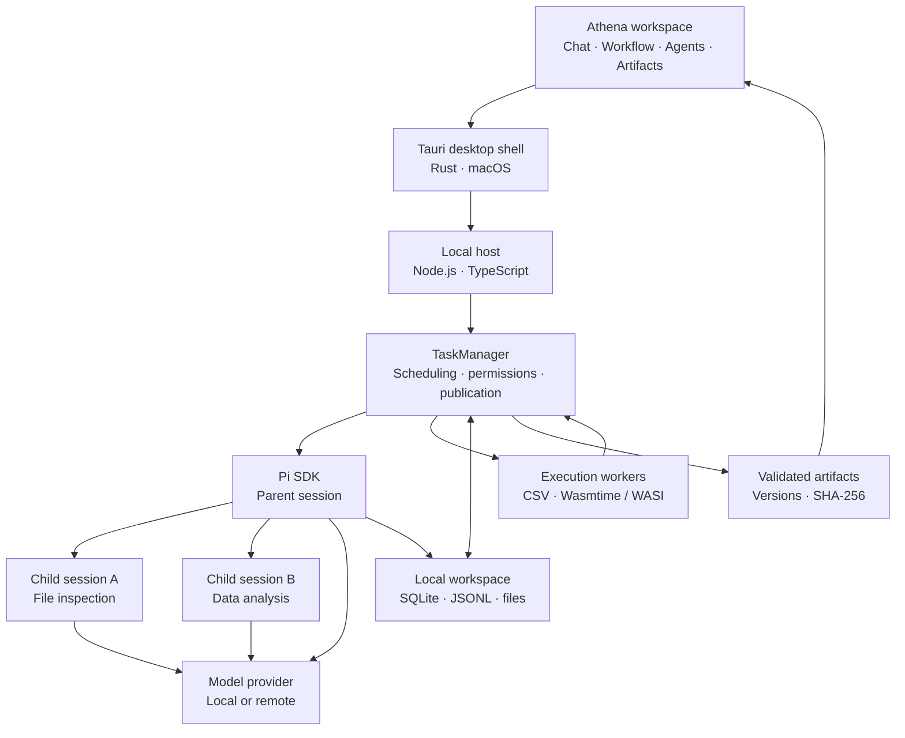

<div align="center">
  <picture>
    <source media="(prefers-color-scheme: dark)" srcset="assets/icon-dark.png">
    
  </picture>

  <h1>Athena</h1>
  <p><strong>A local-first workspace for AI-assisted research.</strong></p>
  <p>Research with agents. Inspect their work. Keep the evidence.</p>

  <a href="https://github.com/yanaire/athena-1/actions/workflows/verify.yml"></a>
  
  

  <p>
    <a href="#overview">Overview</a> ·
    <a href="#capabilities">Capabilities</a> ·
    <a href="#architecture">Architecture</a> ·
    <a href="#quick-start">Quick start</a> ·
    <a href="#documentation">Documentation</a>
  </p>
</div>

> [!IMPORTANT]
> **Source preview, not a public release.** Athena-owned code has a selected Apache-2.0 license, but third-party notices, UI/asset rights and history clearance remain subject to review. The repository's public visibility does not resolve these obligations. Do not redistribute this source candidate or its app until the outstanding gates have been cleared. See [release status](docs/oss-preview-status.md), [third-party notices](THIRD_PARTY_NOTICES.md) and [known limitations](docs/known-limitations.md). No official signed/notarized installer or public DMG is available.

## Overview

Athena is a research-oriented AI agent harness and desktop workspace. Rather than treating an AI answer as the entire outcome, it connects conversations, delegated tasks, file inspection, analysis and traceable result artifacts in one local workspace.

Athena는 연구자의 질문을 독립적인 에이전트 작업과 실제 데이터 분석으로 연결하는 로컬 연구 워크스페이스입니다. 단순한 AI 채팅을 넘어, 어떤 작업이 실행되었고 어떤 파일과 결과가 사용되었는지 확인하는 데 초점을 둡니다.

**Three design principles**

- **Orchestration:** a parent agent delegates independent work to child sessions and combines their results.
- **Traceability:** inspect execution events, task relationships, source files and validated output artifacts.
- **Local control:** keep project files and conversation history on your machine; choose a supported local or remote model provider.

Local-first refers to the workspace and execution environment, not a guarantee that model inference or all data processing stays offline. Remote model providers receive the inputs needed for inference.

## Capabilities

The following describes the current `main` source, not unmerged feature branches.

| Area | Current capability |
| :--- | :--- |
| Research workspace | Projects, research conversations, attachments, streaming responses and persisted history |
| Multi-agent execution | Parent/child Pi sessions, task delegation, concurrency and depth limits, cancellation and workflow inspection |
| Research files | Scoped file reads and built-in CSV statistics; host-validated downloadable artifacts with input versions and SHA-256 receipts |
| Offline analysis | Opt-in Python (CPython/WASI) and JavaScript (QuickJS-ng) execution through Wasmtime, without Docker |
| Model connections | Supported OpenAI and Anthropic API credentials, compatible endpoints, saved model profiles and connection verification |
| Desktop | Apple Silicon macOS source build using Tauri and a bundled Node sidecar |
| Execution visibility | Workflow, Agents, Execution and Artifacts views backed by actual host records |

**In development / not included in this baseline:** MCP integration is being developed separately. Persistent knowledge-library services, versioned PDF and manuscript/review workflows, advanced Pi plugins, approvals and automatic retry are not implemented in the current baseline. See [contract gaps](athena-backend-handoff/CONTRACT-GAPS.md).

## Architecture



The browser-development UI can also connect directly to the local Node host. TaskManager owns scheduling, file grants, run state and artifact publication; the official Pi SDK owns the independent parent/child model sessions and their JSONL histories. The model selection is fixed for a run and its children.

| Layer | Technology |
| :--- | :--- |
| Desktop | Rust · Tauri 2 · WKWebView |
| Agent host | Node.js 24 · TypeScript · Pi SDK 1.5.2 |
| Persistence | SQLite metadata · JSONL session history · project files |
| Analysis | Rust · Wasmtime · CPython/WASI · QuickJS-ng |
| UI transport | Local HTTP RPC · Server-Sent Events |
| Verification | GitHub Actions · TypeScript · Node test runner · Rust tests · Gitleaks |

[Architecture guide](docs/architecture.md) · [Browser/host wire contract](athena-backend-handoff/athena-codex-ui/integrations/host-wire.d.ts) · [Sandbox boundary](docs/sandbox-security.md)

## Quick start

These instructions are for an **authorized local source checkout**. There is no official installer in this preview.

### 1. Browser development

**Requirements:** Node.js 24 (verified toolchain: 24.22.3), npm and an OpenAI-compatible model server supporting streaming and tool calls. Use the actual endpoint and model identifier of your server.

```sh
npm ci --ignore-scripts --no-audit --no-fund

export ATHENA_ENDPOINT=http://127.0.0.1:8080/v1
export ATHENA_MODEL=athena-local

# If required, set ATHENA_API_KEY privately in the host environment.
npm start
```

Open **http://127.0.0.1:4317**. In **Settings → Models**, verify and save the connection. Create a project with **Add project**, then create a conversation with **New research**.

The generated `athena-preview.html` opened directly as a file is a standalone demo, not a connected research runtime. No OmO installation, login or session is required.

### 2. macOS desktop source build

Target: **Apple Silicon · macOS 13.5+**. Install the pinned toolchain and prerequisites described in the [development guide](docs/development.md).

```sh
npm ci --ignore-scripts --no-audit --no-fund
npm run analysis:prepare
npm run desktop:build
```

Output:

```text
src-tauri/target/aarch64-apple-darwin/release/bundle/macos/Athena.app
```

The app bundles the Node runtime, Pi SDK and two analysis interpreters, not model weights or credentials. This development build is not Developer ID signed or notarized. Do not bypass Gatekeeper to claim installation acceptance.

See [installation details](docs/installation.md) and [model providers](docs/model-providers.md).

<details>
<summary><strong>Personal local ChatGPT build</strong></summary>

ChatGPT plan sign-in is disabled in the standard desktop build and browser host. For personal use on the Mac, an alternative developer build can enable the official sign-in route:

```sh
npm run desktop:build:local-chatgpt
```

This uses the same bundle output path with a different app identifier. Copy the existing bundle before switching builds. Account and workspace eligibility are determined by OpenAI; local personal authorization does not imply approval for a remote or commercial deployment.

[Connection instructions](docs/installation.md#personal-local-build-with-chatgpt) · [Verification record](docs/m42/siwc.md)

</details>

## Research example

Use the included synthetic [measurements.csv](docs/measurements.csv) to see the agent-to-artifact workflow.

1. Create a research conversation and attach the CSV.
2. Ask the parent to delegate two tasks, start both and wait for their results.
3. Inspect the child tasks in **Workflow** and download the verified output from **Artifacts**.

**Example prompt**

> Delegate two tasks. Ask the first child to use `read` to check the row count, missing values and units. Ask the second to use `calculate_csv` on `measurement_mV` and produce `statistics.json`. Start both, wait for their results, then report the mean and the actual result-file link.

File reading and the built-in CSV worker do not require the optional analysis runtime. See [M2 acceptance](docs/M2-ACCEPTANCE.md) and [process limits](docs/M2-PROCESSES.md).

## Security and execution boundaries

Athena is intended for a single user on a trusted machine. The host binds to loopback; do not expose it through an external interface or shared proxy. The browser development host is not protected by the desktop's session gate.

- The default browser workspace is `~/.athena/workspace`; `ATHENA_DATA_DIR` and `ATHENA_PORT` are configurable. Restarting does not automatically rerun unfinished work.
- Local conversations, inputs and artifacts are not encrypted by the credential store. Programs running as your OS user may access these files.
- macOS credentials are stored in `~/Library/Application Support/Athena/auth/credentials.v2.json` as plaintext with directory mode `0700` and file mode `0600`. These permissions do not protect against the same OS user, privileged administrators or backups.
- Normal startup does not request Keychain access. The optional **Settings → Models → Approve import from Keychain** route imports an older store; declining leaves it untouched.
- Offline analysis is disabled by default per project. Enable it in **Settings → Agents & execution**. Python uses the WASI standard library; the legacy JavaScript `language: "node"` value selects QuickJS, not Node.js or npm. The sandbox and watchdog are not complete OS isolation.

[Privacy](PRIVACY.md) · [Security policy](SECURITY.md) · [Credential storage](docs/keychain-security.md) · [Analysis security](docs/sandbox-security.md)

<details>
<summary><strong>Runtime limits and host contract</strong></summary>

| Environment variable | Default | Meaning |
| :--- | ---: | :--- |
| `ATHENA_MODEL_CONCURRENCY` | 2 | 1–64; waiting parents yield model slots to children |
| `ATHENA_PROCESS_CONCURRENCY` | 1 | 1–4; separate process limit |
| `ATHENA_MAX_CHILDREN` | 8 | 0–128; direct children per parent execution |
| `ATHENA_MAX_DEPTH` | 1 | 0 disables delegation; 1 allows direct children only |

The browser uses `GET /api/bootstrap`, `POST /api/rpc` and `GET /api/events`. Model verification, configuration persistence and successful generation/tool execution are distinct events. Browser storage is not the source of truth for run history. TaskManager publishes artifacts only after validating ownership, file bytes and input versions.

[Wire types](athena-backend-handoff/athena-codex-ui/integrations/host-wire.d.ts) · [M2 processes](docs/M2-PROCESSES.md)

</details>

## Development and verification

```sh
npm run check
npm run analysis:prepare
npm test
python3 athena-backend-handoff/athena-codex-ui/build.py
```

The [Verify Athena workflow](.github/workflows/verify.yml) checks reachable Git history with Gitleaks, validates types and UI contracts, runs host and controlled-provider tests, audits production npm dependencies and declared licenses, and builds/verifies the Apple Silicon app.

For a separate live-model acceptance run, configure the endpoint and model above:

```sh
node scripts/live-acceptance.mjs
```

This uses real model tokens and a temporary workspace. It checks actual file reads, model output, streamed events, IDs and persisted history after restart. Controlled-provider tests are not a substitute for live-model acceptance, and CI success does not establish public-release clearance.

[Development guide](docs/development.md) · [M1 acceptance](docs/M1-ACCEPTANCE.md) · [M2 acceptance](docs/M2-ACCEPTANCE.md)

## Repository layout

```text
athena-1/
├── runtime/                 # Local agent host and TaskManager
├── src-tauri/               # Rust/Tauri desktop shell
├── sandbox/                 # Rust/WASI analysis helper
├── athena-backend-handoff/  # UI, integration contracts and QA
├── assets/                  # Athena icon variants
├── scripts/                 # Build and acceptance tooling
├── tests/                   # Host and provider regression tests
├── docs/                    # Architecture, security, verification
└── .github/workflows/       # CI verification
```

## Documentation

| Topic | Guide |
| :--- | :--- |
| Getting started | [Installation](docs/installation.md) · [Model providers](docs/model-providers.md) |
| Internals | [Architecture](docs/architecture.md) · [UI integration](athena-backend-handoff/START-HERE.md) |
| Development | [Build and test](docs/development.md) · [Acceptance contract](athena-backend-handoff/ACCEPTANCE.md) |
| Safety | [Privacy](PRIVACY.md) · [Security](SECURITY.md) · [Sandbox](docs/sandbox-security.md) |
| Release | [Preview status](docs/oss-preview-status.md) · [Known limitations](docs/known-limitations.md) · [Release checklist](docs/release-checklist.md) · [M4.2 release notes](docs/m42/release-notes.md) |
| Project policies | [Contributing](CONTRIBUTING.md) · [Code of conduct](CODE_OF_CONDUCT.md) · [Third-party notices](THIRD_PARTY_NOTICES.md) |

## License and contribution status

The selected license for Athena-owned code is [Apache License 2.0](LICENSE). Third-party materials retain their own terms. The [redistribution review](THIRD_PARTY_NOTICES.md) and [public-release gates](docs/oss-preview-status.md) remain controlling; this README does not authorize a wider release or open contributions. Follow the existing [contribution policy](CONTRIBUTING.md).

For security issues, follow [SECURITY.md](SECURITY.md). Private reporting must be enabled and verified before it is relied upon. Do not post vulnerabilities, tokens, personal data or research files in public issues.

---

<div align="center">
  <sub>ATHENA · LOCAL RESEARCH WORKSPACE</sub>
</div>
