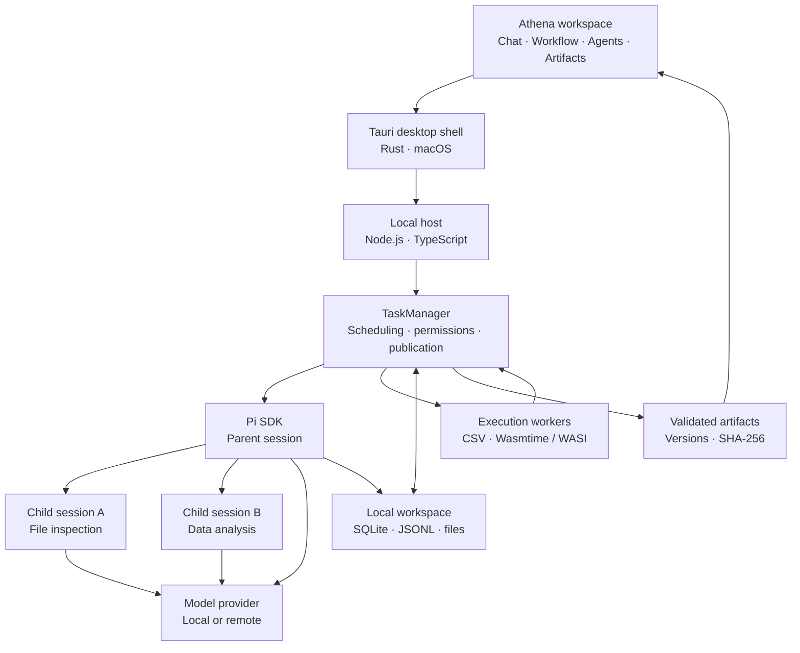

<div align="center">
  <picture>
    <source media="(prefers-color-scheme: dark)" srcset="assets/icon-dark.png">
    
  </picture>

  <h1>Athena</h1>
  <p><strong>Um espaço de trabalho local-first para pesquisa assistida por IA.</strong></p>
  <p>Pesquise com agentes. Inspecione o trabalho. Preserve as evidências.</p>

  <a href="https://github.com/yanaire/athena/actions/workflows/verify.yml"></a>
  
  

  <p>
    <a href="README.md">English</a> · <a href="README.ko.md">한국어</a> · <a href="README.ja.md">日本語</a> · <a href="README.zh-CN.md">简体中文</a> · <a href="README.zh-TW.md">繁體中文</a> · <a href="README.es.md">Español</a> · <a href="README.fr.md">Français</a> · <a href="README.de.md">Deutsch</a> · <strong>Português (Brasil)</strong>
  </p>
</div>

> **Status (2026-11-25):** O candidato de integração revisado para Macs com Apple Silicon inclui o código-fonte de MCP, das extensões de pesquisa e do DAG de fluxos de trabalho.
> A descrição da base e os registros de validação abaixo preservam o histórico de uma versão anterior; a aceitação final em um Mac real com uma conta real ainda está pendente, e o escopo atual da integração está descrito no [README em inglês](README.md) e no [relatório de revisão da integração](docs/validation/2026-11-25-open-pr-integration-review.md).

> [!IMPORTANT]
> **Prévia do código-fonte, não uma versão pública oficial.** O código próprio do Athena adota Apache-2.0, mas os avisos de terceiros, os direitos da interface e dos recursos e a liberação do histórico Git ainda estão em análise. A visibilidade pública do repositório não resolve essas obrigações. Não redistribua o código candidato nem o aplicativo até que as condições pendentes sejam atendidas. Consulte o [status da publicação](docs/oss-preview-status.md), os [avisos de terceiros](THIRD_PARTY_NOTICES.md) e as [limitações conhecidas](docs/known-limitations.md). Não há instalador oficial assinado e notarizado nem DMG público.

## Visão geral

Athena é uma estrutura de execução de agentes de IA e um espaço de trabalho de desktop voltado à pesquisa. Em vez de tratar a resposta da IA como todo o resultado, conecta conversas, tarefas delegadas, inspeção de arquivos, análise e artefatos rastreáveis em um único ambiente local.

**Três princípios de projeto**

- **Orquestração:** um agente principal delega trabalhos independentes a sessões filhas e integra os resultados.
- **Rastreabilidade:** inspecione eventos de execução, relações entre tarefas, arquivos de origem e artefatos validados.
- **Controle local:** mantenha os arquivos de projeto e o histórico de conversas em seu computador e escolha um provedor de modelos local ou remoto compatível.

Local-first se refere ao espaço de trabalho e ao ambiente de execução, não a uma garantia de que a inferência ou todo o processamento seja offline. Provedores remotos recebem as entradas necessárias para a inferência.

## Funcionalidades

A tabela descreve o código atual de `main`, não as branches de funcionalidades ainda não integradas.

| Área | Funcionalidade atual |
| :--- | :--- |
| Espaço de pesquisa | Projetos, conversas, anexos, respostas em streaming e histórico persistente |
| Execução multiagente | Sessões Pi pai/filho, delegação, limites de concorrência e profundidade, cancelamento e inspeção de fluxos |
| Arquivos de pesquisa | Leitura com escopo limitado, estatísticas CSV integradas e artefatos baixáveis validados pelo host, com versões de entrada e comprovantes SHA-256 |
| Análise offline | Execução opcional de Python (CPython/WASI) e JavaScript (QuickJS-ng) via Wasmtime, sem Docker |
| Conexões de modelos | Credenciais de API OpenAI e Anthropic, endpoints compatíveis, perfis salvos e verificação de conexão |
| Desktop | Compilação a partir do código-fonte para macOS Apple Silicon, com Tauri e processo auxiliar Node incluído |
| Visibilidade da execução | Telas Workflow, Agents, Execution e Artifacts baseadas em registros reais do host |

**Em desenvolvimento / fora da base atual:** a integração MCP é desenvolvida separadamente. Biblioteca de conhecimento persistente, fluxos de PDFs versionados, manuscritos e revisões, plugins avançados do Pi, aprovações e novas tentativas automáticas ainda não foram implementados. Consulte as [lacunas do contrato](athena-backend-handoff/CONTRACT-GAPS.md).

## Arquitetura



A interface de desenvolvimento no navegador também pode se conectar diretamente ao host Node local. TaskManager gerencia agendamento, permissões de arquivos, estado de execução e publicação de artefatos; o SDK oficial Pi gerencia sessões de modelo pai/filho independentes e seus históricos JSONL. A escolha do modelo permanece fixa durante uma execução e suas tarefas filhas.

| Camada | Tecnologia |
| :--- | :--- |
| Desktop | Rust · Tauri 2 · WKWebView |
| Host de agentes | Node.js 24 · TypeScript · Pi SDK 1.5.2 |
| Persistência | Metadados SQLite · histórico JSONL · arquivos de projeto |
| Análise | Rust · Wasmtime · CPython/WASI · QuickJS-ng |
| Transporte UI | RPC HTTP local · Server-Sent Events |
| Verificação | GitHub Actions · TypeScript · testes Node e Rust · Gitleaks |

[Guia de arquitetura](docs/architecture.md) · [Contrato navegador/host](athena-backend-handoff/athena-codex-ui/integrations/host-wire.d.ts) · [Limites da sandbox](docs/sandbox-security.md)

## Início rápido

Estas instruções se destinam a uma **cópia local autorizada do código-fonte**. Não há instalador oficial nesta prévia.

### 1. Desenvolvimento no navegador

**Requisitos:** Node.js 24 (versão verificada: 24.22.3), npm e um servidor de modelos compatível com OpenAI, com suporte a streaming e chamadas de ferramentas. Use o endpoint e o identificador reais do modelo.

```sh
npm ci --ignore-scripts --no-audit --no-fund

export ATHENA_ENDPOINT=http://127.0.0.1:8080/v1
export ATHENA_MODEL=athena-local

# If required, set ATHENA_API_KEY privately in the host environment.
npm start
```

Abra **http://127.0.0.1:4317**. Verifique e salve a conexão em **Settings → Models**. Crie um projeto com **Add project** e uma conversa com **New research**.

Abrir diretamente o arquivo gerado `athena-preview.html` mostra uma demonstração independente, não um ambiente de pesquisa conectado. Não é necessário instalar o OmO, fazer login ou abrir uma sessão dele.

### 2. Compilação do desktop para macOS

Destino: **Apple Silicon · macOS 13.5 ou posterior**. Instale as versões fixadas das ferramentas e os requisitos do [guia de desenvolvimento](docs/development.md).

```sh
npm ci --ignore-scripts --no-audit --no-fund
npm run analysis:prepare
npm run desktop:build
```

Saída:

```text
src-tauri/target/aarch64-apple-darwin/release/bundle/macos/Athena.app
```

O aplicativo inclui o runtime Node, o SDK Pi e dois interpretadores de análise, mas não inclui pesos de modelos nem credenciais. Esta compilação de desenvolvimento não foi assinada com Developer ID nem notarizada. Não contorne o Gatekeeper para declarar a instalação validada.

[Detalhes de instalação](docs/installation.md) · [Provedores de modelos](docs/model-providers.md)

<details>
<summary><strong>Compilação pessoal local com ChatGPT</strong></summary>

O login com o plano ChatGPT está desativado na compilação padrão do desktop e no host do navegador. Para uso pessoal no Mac, uma compilação de desenvolvimento alternativa pode habilitar o caminho oficial de login.

```sh
npm run desktop:build:local-chatgpt
```

Ela usa o mesmo caminho de saída com outro identificador de aplicativo. Copie o pacote existente antes de alternar. A OpenAI determina a elegibilidade da conta e do espaço de trabalho; uma autorização de uso pessoal local não implica aprovação para implantação remota ou comercial.

[Instruções de conexão](docs/installation.md#personal-local-build-with-chatgpt) · [Registro de verificação](docs/m42/siwc.md)

</details>

## Exemplo de pesquisa

Use os dados sintéticos incluídos em [measurements.csv](docs/measurements.csv) para acompanhar o fluxo dos agentes aos artefatos.

1. Crie uma conversa de pesquisa e anexe o CSV.
2. Peça ao agente principal que delegue duas tarefas, inicie ambas e aguarde os resultados.
3. Inspecione as tarefas filhas em **Workflow** e baixe a saída validada em **Artifacts**.

**Exemplo de prompt**

> Delegue duas tarefas. Peça ao primeiro agente filho que use `read` para verificar a quantidade de linhas, valores ausentes e unidades. Peça ao segundo que use `calculate_csv` em `measurement_mV` e gere `statistics.json`. Inicie ambos, aguarde os resultados e informe a média e o link do arquivo real de resultados.

A leitura de arquivos e o worker CSV integrado não precisam do runtime opcional de análise. Consulte a [aceitação M2](docs/M2-ACCEPTANCE.md) e os [limites de processos](docs/M2-PROCESSES.md).

## Segurança e limites de execução

Athena foi projetado para um único usuário em um computador confiável. O host escuta em loopback; não o exponha por interfaces externas nem proxies compartilhados. O host de desenvolvimento no navegador não conta com o controle de sessão do desktop.

- O espaço padrão do navegador é `~/.athena/workspace`; `ATHENA_DATA_DIR` e `ATHENA_PORT` são configuráveis. Reiniciar não executa novamente tarefas inacabadas de forma automática.
- Conversas, entradas e artefatos locais não são criptografados pelo armazenamento de credenciais. Programas executados pelo mesmo usuário do sistema operacional podem acessá-los.
- As credenciais do macOS são armazenadas em texto simples em `~/Library/Application Support/Athena/auth/credentials.v2.json`, com permissões `0700` no diretório e `0600` no arquivo. Isso não protege contra o mesmo usuário, administradores privilegiados ou backups.
- A inicialização normal não solicita acesso às Chaves (Keychain). Em **Settings → Models → Approve import from Keychain**, é possível importar o armazenamento antigo; recusá-lo mantém o armazenamento intacto.
- A análise offline vem desativada por padrão em cada projeto. Habilite em **Settings → Agents & execution**. Python usa a biblioteca padrão WASI; o valor JavaScript legado `language: "node"` seleciona QuickJS, não Node.js nem npm. A sandbox e o monitor não fornecem isolamento completo do sistema operacional.

[Privacidade](PRIVACY.md) · [Política de segurança](SECURITY.md) · [Armazenamento de credenciais](docs/keychain-security.md) · [Segurança da análise](docs/sandbox-security.md)

<details>
<summary><strong>Limites de execução e contrato do host</strong></summary>

| Variável de ambiente | Padrão | Significado |
| :--- | ---: | :--- |
| `ATHENA_MODEL_CONCURRENCY` | 2 | 1–64; pais em espera cedem vagas do modelo aos filhos |
| `ATHENA_PROCESS_CONCURRENCY` | 1 | 1–4; limite independente de processos |
| `ATHENA_MAX_CHILDREN` | 8 | 0–128; filhos diretos por execução do pai |
| `ATHENA_MAX_DEPTH` | 1 | 0 desativa a delegação; 1 permite apenas filhos diretos |

O navegador usa `GET /api/bootstrap`, `POST /api/rpc` e `GET /api/events`. A verificação do modelo, a persistência da configuração e o sucesso da geração ou das chamadas de ferramentas são eventos distintos. O armazenamento do navegador não é a fonte oficial do histórico. TaskManager só publica artefatos após validar propriedade, bytes dos arquivos e versões de entrada.

[Tipos de comunicação](athena-backend-handoff/athena-codex-ui/integrations/host-wire.d.ts) · [Processos M2](docs/M2-PROCESSES.md)

</details>

## Desenvolvimento e verificação

```sh
npm run check
npm run analysis:prepare
npm test
python3 athena-backend-handoff/athena-codex-ui/build.py
```

O [workflow Verify Athena](.github/workflows/verify.yml) verifica o histórico Git alcançável com Gitleaks, valida tipos e contratos de UI, executa testes do host e de provedores controlados, audita dependências npm de produção e suas licenças declaradas, e compila e verifica o aplicativo Apple Silicon.

Para um teste de aceitação separado com um modelo real, configure o endpoint e o modelo acima.

```sh
node scripts/live-acceptance.mjs
```

O teste usa tokens reais do modelo e um espaço de trabalho temporário. Verifica a leitura de arquivos, as respostas do modelo, os eventos de streaming, IDs e o histórico persistente após reiniciar. Testes com provedores controlados não substituem a aceitação com modelos reais; o sucesso da CI não comprova a liberação para publicação.

[Guia de desenvolvimento](docs/development.md) · [Aceitação M1](docs/M1-ACCEPTANCE.md) · [Aceitação M2](docs/M2-ACCEPTANCE.md)

## Estrutura do repositório

```text
athena/
├── runtime/                 # Local agent host and TaskManager
├── src-tauri/               # Rust/Tauri desktop shell
├── sandbox/                 # Rust/WASI analysis helper
├── athena-backend-handoff/  # UI, integration contracts and QA
├── assets/                  # Athena icon variants
├── scripts/                 # Build and acceptance tooling
├── tests/                   # Host and provider regression tests
├── docs/                    # Architecture, security, verification
└── .github/workflows/       # CI verification
```

## Documentação

| Tema | Guia |
| :--- | :--- |
| Primeiros passos | [Instalação](docs/installation.md) · [Provedores de modelos](docs/model-providers.md) |
| Componentes internos | [Arquitetura](docs/architecture.md) · [Integração da UI](athena-backend-handoff/START-HERE.md) |
| Desenvolvimento | [Compilação e testes](docs/development.md) · [Contrato de aceitação](athena-backend-handoff/ACCEPTANCE.md) |
| Segurança | [Privacidade](PRIVACY.md) · [Segurança](SECURITY.md) · [Sandbox](docs/sandbox-security.md) |
| Publicação | [Status da prévia](docs/oss-preview-status.md) · [Limitações](docs/known-limitations.md) · [Lista de verificação](docs/release-checklist.md) · [Notas M4.2](docs/m42/release-notes.md) |
| Políticas | [Contribuição](CONTRIBUTING.md) · [Código de conduta](CODE_OF_CONDUCT.md) · [Avisos de terceiros](THIRD_PARTY_NOTICES.md) |

## Licença e status das contribuições

A licença selecionada para o código próprio do Athena é a [Apache License 2.0](LICENSE). Os materiais de terceiros conservam seus próprios termos. A [revisão de redistribuição](THIRD_PARTY_NOTICES.md) e as [condições de publicação](docs/oss-preview-status.md) continuam válidas; este README não autoriza distribuição mais ampla nem abertura de contribuições. Siga a [política de contribuição](CONTRIBUTING.md).

Para questões de segurança, siga [SECURITY.md](SECURITY.md). O canal de denúncia privada deve ser habilitado e verificado antes de ser considerado confiável. Não publique vulnerabilidades, tokens, dados pessoais ou arquivos de pesquisa em issues públicas.

---

<div align="center">
  <sub>ATHENA · LOCAL RESEARCH WORKSPACE</sub>
</div>
