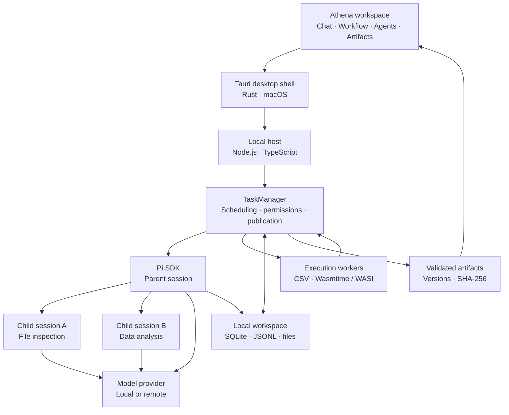

<div align="center">
  <picture>
    <source media="(prefers-color-scheme: dark)" srcset="assets/icon-dark.png">
    
  </picture>

  <h1>Athena</h1>
  <p><strong>面向 AI 辅助研究的本地优先工作空间。</strong></p>
  <p>使用智能体研究，检查执行过程，保留证据。</p>

  <a href="https://github.com/yanaire/athena/actions/workflows/verify.yml"></a>
  
  

  <p>
    <a href="README.md">English</a> · <a href="README.ko.md">한국어</a> · <a href="README.ja.md">日本語</a> · <strong>简体中文</strong> · <a href="README.zh-TW.md">繁體中文</a> · <a href="README.es.md">Español</a> · <a href="README.fr.md">Français</a> · <a href="README.de.md">Deutsch</a> · <a href="README.pt-BR.md">Português (Brasil)</a>
  </p>
</div>

> **当前状态（2026-11-25）：** 已审查的整合候选版本包含 MCP、研究扩展、Workflow DAG 以及 Windows 和 Intel Mac 平台的源代码。
> 下方的基线说明和验证记录保留了旧版本的历史信息，真实 Mac 和真实账号上的最终验收尚未完成，当前整合范围请参阅[英文 README](README.md) 和[整合审查记录](docs/validation/2026-11-25-open-pr-integration-review.md)。

> [!IMPORTANT]
> **源代码预览版，并非正式公开发布版。** Athena 自有代码选用 Apache-2.0，但第三方许可声明、UI 和素材权利以及 Git 历史公开资格仍在审查中。仓库公开并不代表这些义务已经履行。在未解决的发布条件得到满足之前，请勿重新分发此候选源代码或应用。参阅[发布状态](docs/oss-preview-status.md)、[第三方声明](THIRD_PARTY_NOTICES.md)和[已知限制](docs/known-limitations.md)。目前没有经过正式签名及公证的安装程序或公开 DMG。

## 项目概述

Athena 是面向研究的 AI 智能体执行框架和桌面工作空间。它不把 AI 回答视为全部成果，而是在本地工作空间中连接对话、委派任务、文件检查、数据分析和可追溯的结果文件。

**三项设计原则**

- **任务编排：** 父智能体将独立工作委派给子会话，并整合结果。
- **可追溯性：** 检查执行事件、任务关系、源文件和经过验证的成果。
- **本地控制：** 将项目文件和对话历史保存在自己的设备上，并选择支持的本地或远程模型提供方。

本地优先指工作空间及执行环境，并不保证模型推理和所有数据处理均离线进行。远程模型提供方会接收推理所需的输入。

## 主要功能

以下功能以当前 `main` 分支为准，不包含尚未合并的功能分支。

| 领域 | 当前功能 |
| :--- | :--- |
| 研究工作空间 | 项目、研究对话、附件、流式响应、持久化历史 |
| 多智能体执行 | 父子 Pi 会话、任务委派、并发及深度限制、取消、工作流检查 |
| 研究文件 | 限定范围的文件读取、内置 CSV 统计、带输入版本和 SHA-256 凭证的主机验证成果下载 |
| 离线分析 | 通过 Wasmtime 按需执行 Python (CPython/WASI) 和 JavaScript (QuickJS-ng)，无需 Docker |
| 模型连接 | 支持 OpenAI 和 Anthropic API 凭据、兼容端点、保存模型配置及连接验证 |
| 桌面应用 | 基于 Tauri 和内置 Node 辅助进程的 Apple Silicon macOS 源码构建 |
| 执行可视性 | 由真实主机记录支持的 Workflow、Agents、Execution、Artifacts 视图 |

**开发中 / 当前基线未包含：** MCP 集成正在独立开发。持久化知识库、版本化 PDF、稿件和审阅工作流、高级 Pi 插件、审批及自动重试尚未实现。参阅[契约差距](athena-backend-handoff/CONTRACT-GAPS.md)。

## 系统架构



浏览器开发 UI 也可直接连接本地 Node 主机。TaskManager 管理调度、文件授权、运行状态和成果发布；官方 Pi SDK 管理独立的父子模型会话及 JSONL 历史。同一次运行及其子任务使用固定的模型选择。

| 层级 | 技术 |
| :--- | :--- |
| 桌面 | Rust · Tauri 2 · WKWebView |
| 智能体主机 | Node.js 24 · TypeScript · Pi SDK 1.5.2 |
| 持久化 | SQLite 元数据 · JSONL 会话历史 · 项目文件 |
| 分析 | Rust · Wasmtime · CPython/WASI · QuickJS-ng |
| UI 通信 | 本地 HTTP RPC · Server-Sent Events |
| 验证 | GitHub Actions · TypeScript · Node 测试运行器 · Rust 测试 · Gitleaks |

[架构指南](docs/architecture.md) · [浏览器/主机通信契约](athena-backend-handoff/athena-codex-ui/integrations/host-wire.d.ts) · [沙箱边界](docs/sandbox-security.md)

## 快速开始

以下说明适用于**已获授权的本地源代码副本**。预览版没有正式安装程序。

### 1. 浏览器开发

**要求：** Node.js 24（已验证版本 24.22.3）、npm，以及支持流式响应和工具调用的 OpenAI 兼容模型服务器。请使用服务器实际的端点和模型标识符。

```sh
npm ci --ignore-scripts --no-audit --no-fund

export ATHENA_ENDPOINT=http://127.0.0.1:8080/v1
export ATHENA_MODEL=athena-local

# If required, set ATHENA_API_KEY privately in the host environment.
npm start
```

打开 **http://127.0.0.1:4317**。在 **Settings → Models** 验证并保存连接，通过 **Add project** 创建项目，再通过 **New research** 创建对话。

直接打开生成的 `athena-preview.html` 文件只会运行独立演示，并非已连接的研究运行环境。不需要安装、登录或使用 OmO 会话。

### 2. macOS 桌面源码构建

目标：**Apple Silicon · macOS 13.5 或更高版本**。安装[开发指南](docs/development.md)中指定版本的工具链及依赖。

```sh
npm ci --ignore-scripts --no-audit --no-fund
npm run analysis:prepare
npm run desktop:build
```

输出：

```text
src-tauri/target/aarch64-apple-darwin/release/bundle/macos/Athena.app
```

应用内置 Node 运行时、Pi SDK 以及两个分析解释器，不包含模型权重或凭据。此开发构建未经过 Developer ID 签名或公证。不要通过绕过 Gatekeeper 来宣称安装验证通过。

[安装详情](docs/installation.md) · [模型提供方](docs/model-providers.md)

<details>
<summary><strong>个人本地 ChatGPT 构建</strong></summary>

标准桌面构建和浏览器主机禁用 ChatGPT 套餐登录。对于 Mac 上的个人使用，可以通过另一种开发构建启用官方登录方式。

```sh
npm run desktop:build:local-chatgpt
```

此构建使用相同的输出路径但不同的应用标识符。切换之前请复制现有应用包。账户和工作空间的使用资格由 OpenAI 决定；个人本地授权不代表远程或商业部署获批。

[连接说明](docs/installation.md#personal-local-build-with-chatgpt) · [验证记录](docs/m42/siwc.md)

</details>

## 研究示例

使用随附的合成数据 [measurements.csv](docs/measurements.csv)，体验从智能体执行到成果文件的流程。

1. 创建研究对话并附加 CSV。
2. 让父智能体委派两项任务，启动两项任务并等待结果。
3. 在 **Workflow** 查看子任务，在 **Artifacts** 下载验证后的输出。

**提示词示例**

> 委派两项任务。让第一个子智能体用 `read` 检查行数、缺失值和单位；让第二个用 `calculate_csv` 分析 `measurement_mV` 并生成 `statistics.json`。启动两项任务并等待结果，然后报告均值和实际结果文件链接。

文件读取和内置 CSV 工作进程不需要可选分析运行时。参阅 [M2 验收记录](docs/M2-ACCEPTANCE.md)及[进程限制](docs/M2-PROCESSES.md)。

## 安全与执行边界

Athena 面向可信设备上的单一用户。主机仅绑定回环地址，请勿通过外部接口或共享代理暴露。浏览器开发主机没有桌面端的会话认证门控。

- 默认浏览器工作空间为 `~/.athena/workspace`，可配置 `ATHENA_DATA_DIR` 和 `ATHENA_PORT`。重启不会自动重新执行未完成任务。
- 本地对话、输入及成果不会通过凭据存储进行加密。同一操作系统用户运行的程序可访问这些文件。
- macOS 凭据以明文保存在 `~/Library/Application Support/Athena/auth/credentials.v2.json`，目录权限为 `0700`、文件权限为 `0600`。无法防御同一系统用户、特权管理员或备份的访问。
- 正常启动不会请求 Keychain 权限。可在 **Settings → Models → Approve import from Keychain** 导入旧存储；拒绝时原存储保持不变。
- 离线分析在各项目中默认禁用，通过 **Settings → Agents & execution** 启用。Python 使用 WASI 标准库；旧 JavaScript 参数 `language: "node"` 指 QuickJS，而非 Node.js 或 npm。沙箱和监控机制并非完整的操作系统隔离。

[隐私](PRIVACY.md) · [安全政策](SECURITY.md) · [凭据存储](docs/keychain-security.md) · [分析安全](docs/sandbox-security.md)

<details>
<summary><strong>运行限制及主机契约</strong></summary>

| 环境变量 | 默认值 | 含义 |
| :--- | ---: | :--- |
| `ATHENA_MODEL_CONCURRENCY` | 2 | 1–64；等待中的父任务将模型槽位让给子任务 |
| `ATHENA_PROCESS_CONCURRENCY` | 1 | 1–4；独立的进程限制 |
| `ATHENA_MAX_CHILDREN` | 8 | 0–128；每次父任务运行可创建的直接子任务数 |
| `ATHENA_MAX_DEPTH` | 1 | 0 禁用委派；1 仅允许直接子任务 |

浏览器使用 `GET /api/bootstrap`、`POST /api/rpc` 和 `GET /api/events`。模型验证、配置持久化、生成及工具执行成功是独立事件。浏览器存储不是运行历史的权威来源。TaskManager 仅在验证所有权、文件字节和输入版本之后发布成果。

[通信类型](athena-backend-handoff/athena-codex-ui/integrations/host-wire.d.ts) · [M2 进程](docs/M2-PROCESSES.md)

</details>

## 开发与验证

```sh
npm run check
npm run analysis:prepare
npm test
python3 athena-backend-handoff/athena-codex-ui/build.py
```

[Verify Athena 工作流](.github/workflows/verify.yml)使用 Gitleaks 检查可达 Git 历史，验证类型和 UI 契约，运行主机和受控提供方测试，审计生产 npm 依赖及声明的许可证，并构建和验证 Apple Silicon 应用。

如需单独执行真实模型验收测试，请配置上述端点和模型。

```sh
node scripts/live-acceptance.mjs
```

此测试使用真实模型 token 和临时工作空间，检查文件读取、模型输出、流式事件、ID 以及重启后持久化的历史。受控提供方测试不能替代真实模型验收；CI 成功也不代表已获得公开发布许可。

[开发指南](docs/development.md) · [M1 验收](docs/M1-ACCEPTANCE.md) · [M2 验收](docs/M2-ACCEPTANCE.md)

## 仓库结构

```text
athena/
├── runtime/                 # Local agent host and TaskManager
├── src-tauri/               # Rust/Tauri desktop shell
├── sandbox/                 # Rust/WASI analysis helper
├── athena-backend-handoff/  # UI, integration contracts and QA
├── assets/                  # Athena icon variants
├── scripts/                 # Build and acceptance tooling
├── tests/                   # Host and provider regression tests
├── docs/                    # Architecture, security, verification
└── .github/workflows/       # CI verification
```

## 文档

| 主题 | 指南 |
| :--- | :--- |
| 入门 | [安装](docs/installation.md) · [模型提供方](docs/model-providers.md) |
| 内部结构 | [架构](docs/architecture.md) · [UI 集成](athena-backend-handoff/START-HERE.md) |
| 开发 | [构建和测试](docs/development.md) · [验收契约](athena-backend-handoff/ACCEPTANCE.md) |
| 安全 | [隐私](PRIVACY.md) · [安全](SECURITY.md) · [沙箱](docs/sandbox-security.md) |
| 发布 | [预览状态](docs/oss-preview-status.md) · [已知限制](docs/known-limitations.md) · [发布清单](docs/release-checklist.md) · [M4.2 发布说明](docs/m42/release-notes.md) |
| 项目政策 | [贡献](CONTRIBUTING.md) · [行为准则](CODE_OF_CONDUCT.md) · [第三方声明](THIRD_PARTY_NOTICES.md) |

## 许可证与贡献状态

Athena 自有代码选用 [Apache License 2.0](LICENSE)。第三方材料保留各自条款。[重新分发审查](THIRD_PARTY_NOTICES.md)和[公开发布条件](docs/oss-preview-status.md)仍然有效；本 README 不授权扩大分发范围或开放贡献。请遵守现有[贡献政策](CONTRIBUTING.md)。

安全问题请遵循 [SECURITY.md](SECURITY.md)。只有启用并验证私密漏洞报告功能后，才能依赖该渠道。请勿在公开 Issue 发布漏洞、token、个人数据或研究文件。

---

<div align="center">
  <sub>ATHENA · LOCAL RESEARCH WORKSPACE</sub>
</div>
