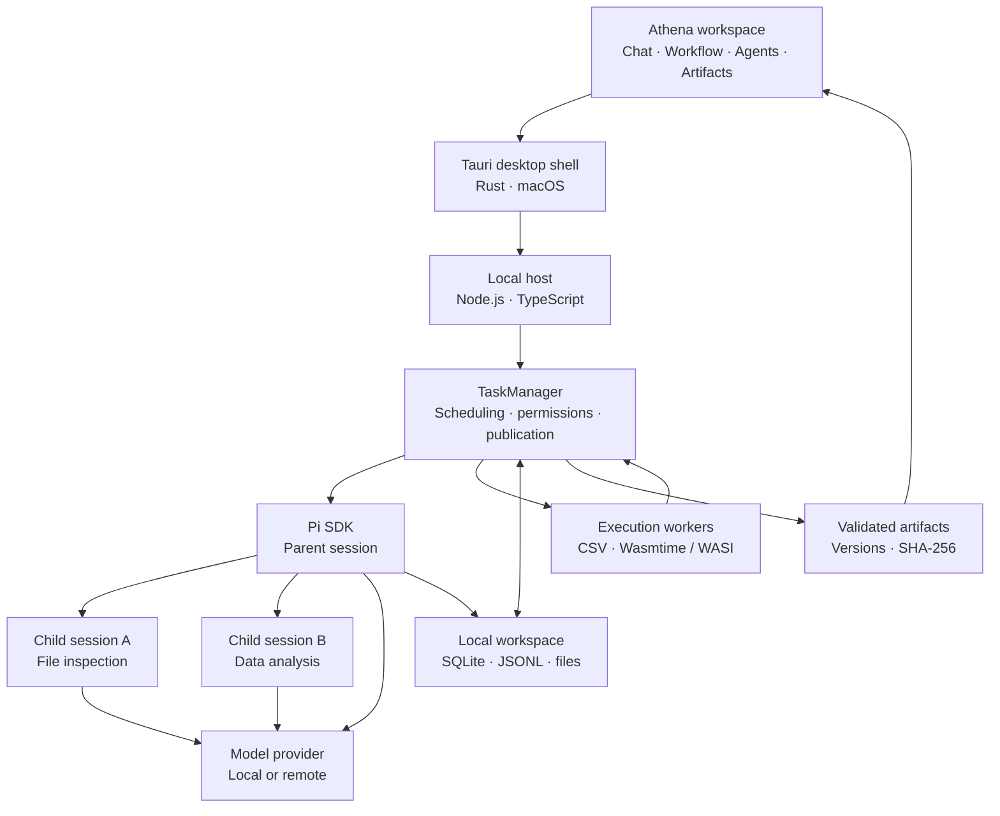

<div align="center">
  <picture>
    <source media="(prefers-color-scheme: dark)" srcset="assets/icon-dark.png">
    
  </picture>

  <h1>Athena</h1>
  <p><strong>面向 AI 輔助研究的本機優先工作空間。</strong></p>
  <p>運用代理程式研究，檢查執行過程，保留證據。</p>

  <a href="https://github.com/yanaire/athena/actions/workflows/verify.yml"></a>
  
  

  <p>
    <a href="README.md">English</a> · <a href="README.ko.md">한국어</a> · <a href="README.ja.md">日本語</a> · <a href="README.zh-CN.md">简体中文</a> · <strong>繁體中文</strong> · <a href="README.es.md">Español</a> · <a href="README.fr.md">Français</a> · <a href="README.de.md">Deutsch</a> · <a href="README.pt-BR.md">Português (Brasil)</a>
  </p>
</div>

> [!IMPORTANT]
> **原始碼預覽版，並非正式公開發行版。** Athena 自有程式碼選用 Apache-2.0，但第三方授權聲明、UI 與素材權利，以及 Git 歷史公開資格仍在審查中。儲存庫的公開狀態並不代表上述義務已履行。在尚未解決的發行條件獲得滿足前，請勿重新散布候選原始碼或應用程式。請參閱[發行狀態](docs/oss-preview-status.md)、[第三方聲明](THIRD_PARTY_NOTICES.md)與[已知限制](docs/known-limitations.md)。目前沒有正式簽署與公證的安裝程式或公開 DMG。

## 專案概述

Athena 是面向研究的 AI 代理程式執行框架與桌面工作空間。它不將 AI 的回答視為全部成果，而是在本機工作空間中連結對話、委派任務、檔案檢查、資料分析及可追溯的產出。

**三項設計原則**

- **任務協調：** 父代理程式將獨立工作委派給子工作階段，並整合結果。
- **可追溯性：** 檢查執行事件、任務關係、來源檔案與經驗證的產出。
- **本機控制：** 將專案檔案與對話記錄保存在自己的電腦上，選擇受支援的本機或遠端模型供應商。

本機優先指工作空間和執行環境，並不保證模型推論或所有資料處理均離線完成。遠端模型供應商會收到推論所需的輸入。

## 主要功能

以下功能以目前的 `main` 為準，不包含尚未合併的功能分支。

| 領域 | 目前功能 |
| :--- | :--- |
| 研究工作空間 | 專案、研究對話、附件、串流回應與持久化記錄 |
| 多代理程式執行 | 父子 Pi 工作階段、任務委派、並行與深度限制、取消與工作流程檢查 |
| 研究檔案 | 限定範圍的檔案讀取、內建 CSV 統計、具輸入版本及 SHA-256 憑證的主機驗證產出下載 |
| 離線分析 | 透過 Wasmtime 選擇啟用 Python (CPython/WASI) 與 JavaScript (QuickJS-ng)，無須 Docker |
| 模型連線 | 支援 OpenAI 與 Anthropic API 憑證、相容端點、模型設定檔儲存及連線驗證 |
| 桌面應用程式 | 基於 Tauri 和內建 Node 輔助程序的 Apple Silicon macOS 原始碼建置 |
| 執行可見性 | 由實際主機記錄支援的 Workflow、Agents、Execution、Artifacts 檢視 |

**開發中 / 目前基準未包含：** MCP 整合正獨立開發。持久化知識庫、版本化 PDF、稿件及審閱工作流程、進階 Pi 外掛、核准及自動重試尚未實作。請參閱[契約差距](athena-backend-handoff/CONTRACT-GAPS.md)。

## 系統架構



瀏覽器開發 UI 也能直接連線到本機 Node 主機。TaskManager 管理排程、檔案授權、執行狀態和產出發布；官方 Pi SDK 管理獨立的父子模型工作階段及其 JSONL 記錄。模型選擇在同一次執行及其子任務中固定。

| 層級 | 技術 |
| :--- | :--- |
| 桌面 | Rust · Tauri 2 · WKWebView |
| 代理程式主機 | Node.js 24 · TypeScript · Pi SDK 1.5.2 |
| 持久化儲存 | SQLite 中繼資料 · JSONL 工作階段記錄 · 專案檔案 |
| 分析 | Rust · Wasmtime · CPython/WASI · QuickJS-ng |
| UI 通訊 | 本機 HTTP RPC · Server-Sent Events |
| 驗證 | GitHub Actions · TypeScript · Node 測試執行器 · Rust 測試 · Gitleaks |

[架構指南](docs/architecture.md) · [瀏覽器/主機通訊契約](athena-backend-handoff/athena-codex-ui/integrations/host-wire.d.ts) · [沙箱邊界](docs/sandbox-security.md)

## 快速開始

以下說明適用於**已獲授權的本機原始碼副本**。此預覽版沒有正式安裝程式。

### 1. 瀏覽器開發

**需求：** Node.js 24（已驗證版本 24.22.3）、npm，以及支援串流回應與工具呼叫的 OpenAI 相容模型伺服器。請使用伺服器實際的端點與模型識別碼。

```sh
npm ci --ignore-scripts --no-audit --no-fund

export ATHENA_ENDPOINT=http://127.0.0.1:8080/v1
export ATHENA_MODEL=athena-local

# If required, set ATHENA_API_KEY privately in the host environment.
npm start
```

開啟 **http://127.0.0.1:4317**，在 **Settings → Models** 驗證並儲存連線。透過 **Add project** 建立專案，再透過 **New research** 建立對話。

直接開啟產生的 `athena-preview.html` 檔案只會執行獨立展示，而非已連線的研究執行環境。無須安裝、登入或使用 OmO 工作階段。

### 2. macOS 桌面原始碼建置

目標：**Apple Silicon · macOS 13.5 或更新版本**。安裝[開發指南](docs/development.md)中指定版本的工具鏈及必要元件。

```sh
npm ci --ignore-scripts --no-audit --no-fund
npm run analysis:prepare
npm run desktop:build
```

輸出：

```text
src-tauri/target/aarch64-apple-darwin/release/bundle/macos/Athena.app
```

應用程式內含 Node 執行環境、Pi SDK 與兩個分析直譯器，不含模型權重或憑證。此開發建置未經 Developer ID 簽署或公證。請勿藉由繞過 Gatekeeper 宣稱安裝驗證通過。

[安裝詳情](docs/installation.md) · [模型供應商](docs/model-providers.md)

<details>
<summary><strong>個人本機 ChatGPT 建置</strong></summary>

標準桌面建置與瀏覽器主機停用 ChatGPT 方案登入。若在 Mac 上個人使用，可透過另一種開發建置啟用官方登入方式。

```sh
npm run desktop:build:local-chatgpt
```

此建置使用相同的輸出路徑，但應用程式識別碼不同。切換前請複製現有套件。帳戶及工作空間資格由 OpenAI 決定；個人本機授權不等於遠端或商業部署核准。

[連線說明](docs/installation.md#personal-local-build-with-chatgpt) · [驗證記錄](docs/m42/siwc.md)

</details>

## 研究範例

使用隨附的合成資料 [measurements.csv](docs/measurements.csv)，體驗從代理程式到產出的流程。

1. 建立研究對話並附加 CSV。
2. 請父代理程式委派兩項任務，啟動兩者並等待結果。
3. 在 **Workflow** 檢視子任務，從 **Artifacts** 下載驗證後的輸出。

**提示詞範例**

> 委派兩項任務。第一個子代理程式使用 `read` 檢查列數、缺失值與單位；第二個使用 `calculate_csv` 分析 `measurement_mV` 並產生 `statistics.json`。啟動兩項任務並等待結果，再回報平均值與實際結果檔案連結。

檔案讀取和內建 CSV 工作程序不需要選用的分析執行環境。參閱 [M2 驗收記錄](docs/M2-ACCEPTANCE.md)及[程序限制](docs/M2-PROCESSES.md)。

## 安全與執行邊界

Athena 適用於可信任電腦上的單一使用者。主機僅繫結迴路位址，請勿透過外部介面或共用 Proxy 暴露。瀏覽器開發主機沒有桌面端的工作階段驗證閘門。

- 預設瀏覽器工作空間為 `~/.athena/workspace`；可設定 `ATHENA_DATA_DIR` 和 `ATHENA_PORT`。重新啟動不會自動重跑未完成的工作。
- 本機對話、輸入和產出不會由憑證儲存區加密。同一作業系統使用者執行的程式可以存取這些檔案。
- macOS 憑證以純文字儲存在 `~/Library/Application Support/Athena/auth/credentials.v2.json`，目錄權限為 `0700`、檔案權限為 `0600`。無法防止相同系統使用者、具權限的管理員或備份存取。
- 正常啟動不會要求 Keychain 存取。在 **Settings → Models → Approve import from Keychain** 可選擇匯入舊儲存區；拒絕時舊儲存區維持原狀。
- 每個專案預設停用離線分析，可透過 **Settings → Agents & execution** 啟用。Python 使用 WASI 標準函式庫；舊 JavaScript 參數 `language: "node"` 代表 QuickJS，而非 Node.js 或 npm。沙箱與監控機制並非完整作業系統隔離。

[隱私](PRIVACY.md) · [安全政策](SECURITY.md) · [憑證儲存](docs/keychain-security.md) · [分析安全](docs/sandbox-security.md)

<details>
<summary><strong>執行限制與主機契約</strong></summary>

| 環境變數 | 預設值 | 意義 |
| :--- | ---: | :--- |
| `ATHENA_MODEL_CONCURRENCY` | 2 | 1–64；等待中的父任務將模型執行名額讓給子任務 |
| `ATHENA_PROCESS_CONCURRENCY` | 1 | 1–4；獨立程序限制 |
| `ATHENA_MAX_CHILDREN` | 8 | 0–128；每次父任務執行的直屬子任務數 |
| `ATHENA_MAX_DEPTH` | 1 | 0 停用委派；1 僅允許直屬子任務 |

瀏覽器使用 `GET /api/bootstrap`、`POST /api/rpc` 與 `GET /api/events`。模型驗證、設定持久化、生成及工具執行成功是不同事件。瀏覽器儲存區不是執行記錄的權威來源。TaskManager 僅在驗證所有權、檔案位元組和輸入版本後發布產出。

[通訊型別](athena-backend-handoff/athena-codex-ui/integrations/host-wire.d.ts) · [M2 程序](docs/M2-PROCESSES.md)

</details>

## 開發與驗證

```sh
npm run check
npm run analysis:prepare
npm test
python3 athena-backend-handoff/athena-codex-ui/build.py
```

[Verify Athena 工作流程](.github/workflows/verify.yml)透過 Gitleaks 檢查可達 Git 歷史、驗證型別及 UI 契約、執行主機及受控供應商測試、稽核正式環境 npm 相依性與宣告授權，以及建置和驗證 Apple Silicon 應用程式。

若要獨立執行真實模型驗收，請設定上述端點及模型。

```sh
node scripts/live-acceptance.mjs
```

此測試使用真實模型 token 和暫存工作空間，檢查檔案讀取、模型輸出、串流事件、ID 及重新啟動後的持久化記錄。受控供應商測試不能取代真實模型驗收，CI 成功也不代表公開發行已獲核准。

[開發指南](docs/development.md) · [M1 驗收](docs/M1-ACCEPTANCE.md) · [M2 驗收](docs/M2-ACCEPTANCE.md)

## 儲存庫結構

```text
athena/
├── runtime/                 # Local agent host and TaskManager
├── src-tauri/               # Rust/Tauri desktop shell
├── sandbox/                 # Rust/WASI analysis helper
├── athena-backend-handoff/  # UI, integration contracts and QA
├── assets/                  # Athena icon variants
├── scripts/                 # Build and acceptance tooling
├── tests/                   # Host and provider regression tests
├── docs/                    # Architecture, security, verification
└── .github/workflows/       # CI verification
```

## 文件

| 主題 | 指南 |
| :--- | :--- |
| 入門 | [安裝](docs/installation.md) · [模型供應商](docs/model-providers.md) |
| 內部結構 | [架構](docs/architecture.md) · [UI 整合](athena-backend-handoff/START-HERE.md) |
| 開發 | [建置和測試](docs/development.md) · [驗收契約](athena-backend-handoff/ACCEPTANCE.md) |
| 安全 | [隱私](PRIVACY.md) · [安全](SECURITY.md) · [沙箱](docs/sandbox-security.md) |
| 發行 | [預覽狀態](docs/oss-preview-status.md) · [已知限制](docs/known-limitations.md) · [發行清單](docs/release-checklist.md) · [M4.2 發行說明](docs/m42/release-notes.md) |
| 專案政策 | [貢獻](CONTRIBUTING.md) · [行為準則](CODE_OF_CONDUCT.md) · [第三方聲明](THIRD_PARTY_NOTICES.md) |

## 授權與貢獻狀態

Athena 自有程式碼選用 [Apache License 2.0](LICENSE)。第三方素材保留其各自條款。[重新散布審查](THIRD_PARTY_NOTICES.md)和[公開發行條件](docs/oss-preview-status.md)仍有效；本 README 不授權擴大散布範圍或開放貢獻。請遵守現有[貢獻政策](CONTRIBUTING.md)。

安全問題請依循 [SECURITY.md](SECURITY.md)。私人漏洞通報功能必須啟用並驗證後才能依賴。請勿在公開 Issue 中發布漏洞、token、個人資料或研究檔案。

---

<div align="center">
  <sub>ATHENA · LOCAL RESEARCH WORKSPACE</sub>
</div>
