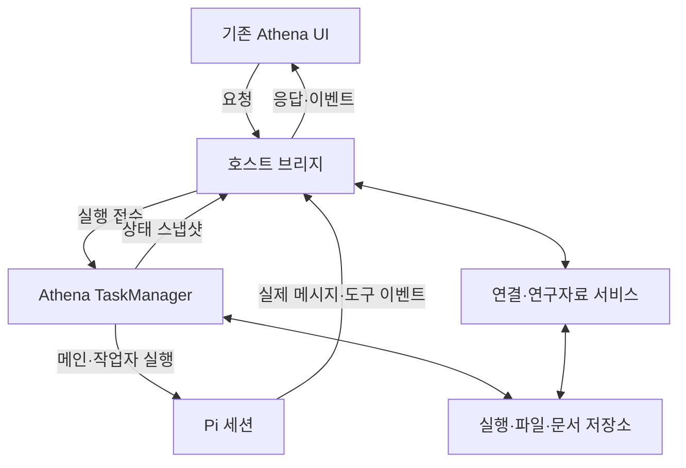

# Athena 백엔드 개발 인계서

작성일: 2026-11-20  
대상: 현재 Athena UI에 실제 모델·실행·저장 기능을 연결할 백엔드 개발자  
기준: athena-preview.html / 기존 소스 ZIP의 바이트를 보존한 사본

## 1. 요청의 목적과 현재 상태

기존 Athena UI의 디자인과 컴포넌트를 유지한 채, 실제 Pi 세션, Athena TaskManager, 연결 관리, 파일·문서 저장 서비스를 붙인다. 채팅의 실제 실행이 Workflow, Agents, Execution, Artifacts, Knowledge, Manuscript에 동일한 식별자와 버전으로 이어지는 것이 목표다.

현재 전달물은 실행 가능한 **독립 HTML UI + 연결 어댑터 + 타입 계약 + fixture 기반 검사**다. 서버, 모델 자격 증명, TaskManager 스케줄러, 데이터베이스, 원본 파일 저장소, 추출기, PDF 생성기가 포함된 완성 백엔드는 아니다.

기존 검증 기록은 UI 통합 검사 93/93, 계약 검사 51/51이며, 이번 인계 시 해당 소스 해시가 기준 파일과 일치함을 확인했다. 실제 모델·서버·영속 저장·브라우저 화면·TypeScript 컴파일을 통과했다는 뜻은 아니다. 검사 방법과 미검증 범위는 기존 qa 보고서에 명시되어 있다.

인계 점검에서 추가로 확인한 문서 head/history 문제와 빠진 원격 원본 조회 계약은 [CONTRACT-GAPS.md](CONTRACT-GAPS.md)에 기록했다. 이 목록은 개발 시작 전의 필수 계약 보완 사항이다. 이번 인계 패키지는 기준 UI를 수정하지 않았다.

## 2. 전달물과 읽는 순서

아래 상대 경로는 이 ZIP을 해제한 최상위 폴더 기준이다.

| 순서 | 파일 | 용도 |
| --- | --- | --- |
| 1 | [START-HERE.md](START-HERE.md) | 착수 지시, 첫 납품 범위, 실행 명령 |
| 2 | [CONTRACT-GAPS.md](CONTRACT-GAPS.md) | 현재 계약으로 부족한 부분과 UI·백엔드 공동 수정 필요 사항 |
| 3 | 이 문서 | 구조, 책임, 호출 계약, 구현 순서 |
| 4 | [ACCEPTANCE.md](ACCEPTANCE.md) | 실제 서비스로 증명해야 하는 완료 조건 |
| 5 | [기존 UI README](athena-codex-ui/README.md) | 화면과 컴포넌트 설명 |
| 6 | [기존 요구사항 1–15 대응표](athena-codex-ui/docs/RUNTIME-READINESS.md) | 이미 준비한 기능과 남은 작업 |
| 7 | [integrations 계약 및 어댑터](athena-codex-ui/integrations/task-manager.d.ts) | 구현 시 준수할 현재 함수·반환 형식 |
| 8 | [BASELINE.json](BASELINE.json) | 기준 파일과 전체 소스의 해시, 검증 기록 |
| 9 | [handoff-audit.json](handoff-audit.json) | 과거 문서 읽기의 head 변경 문제를 재현한 결과 |

**athena-codex-ui/**에는 이전에 전달한 소스 ZIP의 120개 파일을 원본 그대로 넣었다. UI를 수정하려면 소스 파일을 변경하고 build.py로 HTML을 재생성한다. 생성된 HTML만 직접 편집하면 다음 빌드에서 변경이 사라진다.

## 3. 구현 방향과 책임

### 권장 착수안 — 새 백엔드 설계 제안

현재 어댑터와 Pi 연동을 활용하는 TypeScript 호스트를 먼저 구성하는 방향을 권장한다. 이것은 이미 만들어진 백엔드 스택이라는 의미가 아니다. 데스크톱 셸, 프로세스 경계, IPC/HTTP/WebSocket 전송 방식은 착수 단계에서 정하고 기록한다. 기존 UI를 React/Tailwind 등으로 옮기는 작업은 이번 백엔드 연동의 선행 조건이 아니다.

메타데이터는 트랜잭션을 지원하는 관계형 저장소, 원본과 결과물은 버전별 파일 저장소로 시작할 수 있다. 단일 사용자 로컬 앱이면 SQLite와 명시적인 앱 데이터 디렉터리는 가능한 초기 선택이다. DB 제품·ORM·셸은 제안이며 현재 프로젝트에 설치되거나 확정된 사항은 아니다.



이 그림은 권장 소유 관계다. 현재 모든 서비스가 존재한다는 표시가 아니다.

| 모듈 | 소유할 책임 |
| --- | --- |
| UI | 입력·표시·선택·접근성·로컬 초안, 실제 결과를 반영하는 상태 투영 |
| 호스트 브리지 | 요청 상관관계, 활성 세션 바인딩, 이벤트 전달, 파일 전송, 연결 세대 분리 |
| Athena TaskManager | 실행 접수, 작업 의존성, 동시 실행, 실제 서브에이전트 생성, 승인, 재시도, 취소, 복구 |
| Pi 세션 | 선택한 모델과의 대화, 스트리밍, 실제 도구 호출 및 SDK가 제공하는 세션 동작 |
| ConnectionManager | 비밀을 제외한 연결 설정, 실제 연결 확인, 확인된 모델 참조, 세션 생성 |
| FileService | 첨부 staging, 실제 원본 저장, 참조 검증과 모델이 읽을 수 있는 내용 해석 |
| ResearchRecordService | 프로젝트 자료, 추출, 문서 버전, 근거·검토, 정확한 버전 PDF |
| 영속 저장소 | 프로젝트·세션·실행 기록, 원본 바이트, 문서·자료 버전, 복구 정보 |

**ui/workspace-store.js**의 타이머 scheduler는 개발 예제다. 실제 실행은 백엔드 TaskManager가 맡고 **ui/workspace-session.js**는 결과를 구독한다.

## 4. 현재 UI가 실제로 제공하는 연결 지점

다음 이름은 현재 app.js의 공개 API다.

| 공개 API | 전달할 객체 |
| --- | --- |
| AthenaApp.attachPiSession(adapter) | 실제 Pi 세션 또는 호스트 프록시 |
| AthenaApp.attachPiTransport(transport, options?) | request/send/subscribe를 제공하는 기존 RPC 전송 객체 |
| AthenaApp.attachTaskManager(adapter) | getSnapshot/subscribe와 지원하는 수명주기·실행 제어 메서드 |
| AthenaApp.attachConnectionManager(adapter) | saveConfig/verifyConnection/createSession 및 상태 구독 |
| AthenaApp.attachResearchService(adapter) | 하나의 연구 서비스 또는 documents/knowledge 서비스 묶음 |

Pi 연결 해제는 detachPiSession을 사용한다. 나머지 서비스는 detachTaskManager, detachConnectionManager, detachResearchService로 해제한다. TaskManager의 attach는 초기 snapshot 수신을 기다리는 비동기 동작이다. UI의 destroy/detach를 실행 종료나 서버 작업 취소로 취급하지 않는다.

아래는 **실제 호스트 객체가 준비된 뒤의 배선 예시**다. host 객체 생성이나 서버 구현을 제공하는 코드가 아니다.

```js
AthenaApp.attachConnectionManager(host.connections);
await AthenaApp.attachTaskManager(host.taskManager);
AthenaApp.attachResearchService({
  documents: host.documents,
  knowledge: host.knowledge
});
AthenaApp.attachPiSession(host.activePiProxy);
```

JSON 전송에서는 함수가 포함된 connection 객체를 보낼 수 없다. 백엔드는 세션 metadata를 반환하고, UI 측 호스트 프록시가 해당 실제 세션에 묶인 request/send/subscribe 객체를 구성한다. 현재 UI는 그 프록시가 보고하는 Pi sessionId가 선택된 conversation ID와 같을 때 전송·모델 변경을 허용한다.

## 5. Pi 세션·호스트 어댑터

구현 파일: [integrations/pi-host-adapter.mjs](athena-codex-ui/integrations/pi-host-adapter.mjs)  
설명: [PI-HOST-ADAPTER.md](athena-codex-ui/docs/PI-HOST-ADAPTER.md)  
작업 목록: [PI-CAPABILITIES.md](athena-codex-ui/docs/PI-CAPABILITIES.md)

기존 createPiHostAdapter(options)는 이미 생성된 SDK runtime 또는 session 객체를 감싼다. SDK 설치·인증·프로세스 생성·전송 서버를 만들지 않는다.

```js
import { createPiHostAdapter } from './integrations/pi-host-adapter.mjs';

const adapter = createPiHostAdapter({
  runtime,          // 실제 생성한 SDK runtime
  SessionManager,   // SDK 클래스; 인스턴스와 구분
  theme,
  fileService       // 구현한 경우에만 전달
});
```

runtime 대신 고정 session을 전달할 수 있지만 runtime 전용 수명주기 기능까지 사용할 수 있다고 광고하면 안 된다. capabilities는 실제 메서드 지원 여부와 일치시킨다.

호스트 어댑터는 mode, capabilities, request(command), send(response), subscribe(listener), refreshSession(), destroy()를 제공한다. request ID와 response ID, extension dialog ID를 전송 경계에서 보존한다. 외부에서 Pi 세션을 교체하면 기존 호스트의 rebind hook에서 refreshSession을 호출하거나 subscribeSessionChanges를 연결한다. ownsRuntimeRebind는 그 hook을 이 어댑터가 독점 소유할 때만 사용한다.

어댑터가 extension을 자동으로 bind하지 않는다. 호스트는 초기 세션과 교체된 세션에서 session.bindExtensions(...)를 호출하고, 어댑터의 extensionBindings와 기존 lifecycle/abort/shutdown binding을 함께 보존한다. refreshSession만으로 이 초기화가 끝난다고 가정하지 않는다.

기존 소스가 명시한 기준은 **@earendil-works/pi-coding-agent 1.5.2 / commit 653f332b6fe22e2e927dd3d553d20234a3de27f0**다. 이는 전달 소스의 목표 버전이며, 새 프로젝트에 실제 설치·컴파일한 결과가 아니다. 개발자는 첫 커밋에서 사용 SDK 버전과 lockfile을 고정하고 실제 export·메서드·타입을 대조한다. 공식 자료와 추가 확인 범위는 [SDK-SOURCES.md](SDK-SOURCES.md)를 읽는다.

## 6. 실제 실행 시작과 서브에이전트

### 실행 시작 경로

현재 AthenaTaskManager 타입에는 startRun/submitTask가 없다. 채팅은 Pi-compatible proxy의 prompt로 보낸다. 그러므로 존재하지 않는 시작 API를 UI가 이미 호출한다고 가정하면 안 된다.

권장 구현은 브리지 뒤에 하나의 실행 접수 모듈을 두는 것이다. 이 모듈 이름은 설계 제안이다.

1. prompt 요청의 연결 세대, 활성 대화, 프로젝트, 입력 제한과 참조를 확인한다.
2. TaskManager가 접수 기록과 실행 소유권을 확보한다. 큐에 대기하는 제출과 실제 시작된 실행을 구분한다.
3. 실제 dispatch/start 시점에 실행 모델과 설정 revision을 확정하고 Pi에 제출한다. 브리지와 scheduler가 각각 같은 prompt를 중복 제출하지 않게 한다. 한 실행 안에서 도구 후속 턴이나 재시도로 발생하는 여러 모델 호출은 정상이다.
4. 실제 agent_start·도구·완료 이벤트에 따라 run/task 상태와 snapshot을 갱신한다.
5. extension이 요청을 처리하거나 큐에 넣은 경우 해당 실제 결과를 반환한다. 모델 실행이 시작되지 않았는데 running/succeeded를 만들지 않는다.

prompt의 조기 응답은 접수 결과이며 답변 생성 완료가 아니다. agent_end 뒤에도 recovery나 queued work가 이어질 수 있다. 해당 Pi 세션이 자동으로 더 진행하지 않는 경계는 agent_settled로 확인하고, 전체 Athena run은 자식 작업과 결과 저장까지 정산한 뒤 종료한다. extension의 handled 결과만으로 모델 실행 기록을 만들지 않는다.

전용 실행 시작 API를 추가하는 대안을 택하면 .d.ts, app.js, 브리지, 회귀 검사를 같은 변경으로 합의해야 한다.

### 서브에이전트

TaskManager가 실제 작업자 Pi 세션을 생성하고 종료·자원 해제를 관리한다. 별도 작업자 세션의 출력은 해당 agent/task/tool에 연결한다.

- 메인 Pi 스트림은 현재 채팅 응답으로 전달한다.
- 작업자 progress·도구·결과물은 TaskManager snapshot/event를 통해 Agents/Workflow/Execution/Artifacts에 전달한다.
- 현재 UI의 Scope.sessionId는 **부모 Athena 대화의 ID**다. 작업자 Pi의 내부 세션 ID는 백엔드가 별도 매핑한다.
- 다른 작업자의 최종 답변을 메인 채팅의 message_end로 무조건 합치지 않는다.
- 도구 ID는 모든 작업자 사이에서 충돌하지 않게 정규화한다. 메인 Pi 투영과 TaskManager가 같은 도구를 가리킬 때는 UI에 전달하는 ID가 같아야 한다.
- 원래 Pi toolCallId와 내부 worker session ID를 보관해 진단·취소·결과 연결에 사용한다.
- 현재 pi-activity는 일부 ID를 300 UTF-16 코드 단위로 제한한다. 짧고 안정적인 ID를 생성하고 경로·원문 전체를 ID에 넣지 않는다.
- 작업 진척도를 실제로 측정하지 못하면 progress/total을 생략한다. 임의의 증가 퍼센트를 만들지 않는다.

재시도마다 실행 시도를 구분하고 이전 로그·결과물을 보존한다. 현재 공개 계약에는 attemptId가 없으므로 시도 구분을 UI에 노출하려면 추가 계약을 함께 정의한다.

## 7. TaskManager의 현재 계약

정본: [task-manager.d.ts](athena-codex-ui/integrations/task-manager.d.ts)

| 메서드 | 현재 역할 |
| --- | --- |
| getSnapshot() | 현재 authoritative 전체 상태 반환 |
| subscribe(listener) | 변경 snapshot 전달, unsubscribe 함수 반환 |
| createProject({name, defaultModel?}) | 실제 project.id를 포함한 생성 결과 |
| createSession({projectId, title, model?, configurationId?}) | 실제 sessionId 및 선택적 connection/snapshot |
| openSession(sessionId) | 해당 세션 활성화 결과 |
| setProjectDefaultModel(projectId, model 또는 null) | saved:true와 갱신 snapshot |
| retryTask(taskId) | 실제 재시도 요청 |
| cancelRun(runId) | 실제 실행 취소 요청 |
| decideApproval(approvalId, decision) | 해당 승인 요청의 approved/rejected 결정 |

capabilities 배열과 실제 callable method가 모두 있어야 UI가 기능을 활성화한다. 메서드 이름만 두고 성공 값을 반환하는 구현을 납품 완료로 세지 않는다.

snapshot에는 revision, projectId, sessionId, projects, sessions, run, tasks, agents, tools, artifacts, events, approvals가 들어간다. revision은 한 연결의 구독 안에서 **프로젝트/세션 전환을 포함해 단조 증가하는 안전한 정수**여야 한다. 현재 UI는 이전 revision과 이전 연결의 늦은 응답을 버린다. 현재 UI는 delta patch를 병합하지 않으므로 전체 snapshot을 제공한다.

모든 scoped record에는 실제 project/session/run 및 해당 task/agent/tool/artifact 참조를 넣는다. 다른 세션의 데이터를 필드를 생략해 전역 데이터처럼 보내지 않는다. 이벤트의 at과 실행 시간은 실제 관측값을 사용한다.

기존 상태 enum은 ready, queued, running, blocked, paused, succeeded, failed, cancelled다. 취소 요청이 접수된 것과 실제 프로세스가 끝난 것은 별도 사실이다. 종료 확인 전에는 cancelled로 확정하지 않는다. 별도 cancelling 상태가 필요하다면 UI와 타입을 같이 확장한다.

## 8. 연결 설정과 네 모델 범위

정본: [connections.d.ts](athena-codex-ui/integrations/connections.d.ts)

| 동작 | 필요한 실제 반환/행동 |
| --- | --- |
| saveConfig(config) | 저장 후 saved:true, 비어 있지 않은 configurationId, 필요 시 revision·실제 defaultModel |
| verifyConnection(config) | 실제 endpoint 확인 후 connected 또는 failed; 설정 저장과 세션 생성을 하지 않음 |
| createSession(request) | 실제 생성된 sessionId; ID가 없으면 UI가 실패로 처리 |
| getState() | 현재 UI는 동기 snapshot만 사용. 비동기 초기화는 subscribe로 알림 |
| subscribe(listener) | 확인된 설정 ID·연결 상태·기본 모델 전달 |

UI 입력의 provider 값 openai-compatible/local/custom은 연결 종류다. 실제 Pi provider 키와 같다고 가정하지 않는다. defaultModel 저장 응답은 실제 provider/modelId/지원 reasoning으로 해석한다.

비밀 정보는 UI 설정 타입에 없으며, 브라우저 localStorage나 snapshot에 넣지 않는다. 호스트가 자격 증명과 그 참조를 관리한다.

기본 모델 해석 순서:

1. 명시적인 현재 대화 override가 있으면 그 대화에서 사용한다.
2. 새 대화는 프로젝트 기본 모델을 사용한다.
3. 없으면 호스트가 확인한 앱 기본 모델을 사용한다.
4. 모두 없으면 호스트 기본값으로 해석하되, 실제 선택 결과를 반환한다.

실행 시작 시에는 최종 provider/modelId/reasoning을 run record에 고정한다. 이후 앱 기본값·프로젝트 기본값·다른 대화의 선택이 과거 run.model을 바꾸지 않아야 한다.

New research의 현재 생성 우선순위는 TaskManager → ConnectionManager → Pi new_session이다. 두 서비스가 생성 기능을 제공해도 같은 세션 저장소와 동일한 활성화 규칙을 사용한다.

## 9. 입력·파일·요청 보존

정본: [pi-bridge-contracts.d.ts](athena-codex-ui/integrations/pi-bridge-contracts.d.ts)

- 기본 메시지 한도는 262144 UTF-16 코드 단위다. 원문을 자르거나 임의로 요약해서 통과시키지 않는다.
- 전체 text/code 첨부를 합친 최종 message에도 한도를 적용한다. 기본 UI의 inline text file 한도는 1 MiB다.
- 지원하는 이미지 모델·연결만 실제 image payload를 받는다.
- fileService를 제공할 경우 staging과 resolveReferences를 실제로 구현한다.
- stageFiles는 모든 파일의 id, projectId, name, mimeType, size, 선택적 versionId를 반환한다.
- resolveReferences는 각 참조의 존재·권한·프로젝트·버전을 확인하고 resolvedIds와 읽을 수 있는 전체 contextText/이미지를 반환한다.
- 문자열 파일명만 응답하는 것은 파일 내용 전달 완료가 아니다.
- 지원하지 않는 파일이나 전체 입력 초과는 명시적으로 실패시키고 UI가 초안을 유지하도록 한다.
- 서버가 요청을 받았는지 불확실한 연결 종료에서는 무조건 재실행하지 않는다. 요청 ID를 보관하고 재조회/재전송 정책을 정의한다.
- UI의 메모리 복구와 앱 종료 이후의 durable draft 복구는 별도 기능이다. 후자가 필요하면 별도 저장 계약과 파일 업로드 시점을 합의한다.

Extension UI pending은 화면의 20개 페이지 제한과 무관하게 유지한다. 취소는 원래 연결의 원래 요청에 전달한다. 실패·타임아웃·재연결이 승인이나 완료로 변환되지 않게 한다. 서버 재시작 이후 pending을 복구할지, 미확인으로 종료할지 명시하고 실제 상태를 반환한다.

TaskManager approval과 Pi extension dialog는 서로 다른 요청 종류다. 공통 UI처럼 보이더라도 ID와 응답 라우팅을 섞지 않는다.

## 10. Knowledge·문서·PDF

정본: [research-records.d.ts](athena-codex-ui/integrations/research-records.d.ts)

### Knowledge

현재 API는 listSources, storeSource, extractSource 및 source.updated 이벤트다.

storeSource 응답은 요청한 sourceId를 유지하고, 정확한 projectId/version/originalLocation.uri/persistence:host를 반환한다. 내부 저장소 ID가 다르면 어댑터에서 매핑한다. 브라우저 File 객체를 받는 계약은 실제 bytes 전송 방식까지 제공하는 것이 아니다. 전송 계층을 구현해야 한다.

PDF preview, extraction ready, review approved를 각각 관리한다. extraction ready는 동일 source version의 text 문자열을 포함해야 한다. 원본 파일 변경 시 이전 원본·추출·검토 기록을 유지하고 새 버전의 상태를 따로 만든다.

현재 getOriginalFile은 메모리 파일 조회일 뿐이다. 재시작 후 원본 복원에는 CONTRACT-GAPS의 원격 원본 조회 확장이 필요하다.

### 문서·검토

현재 getDocument({projectId, documentId, version?}), saveDocument(...), exportPDF(...)를 호출한다.

저장 시 expectedCurrentVersion을 원자적으로 검사한다. 서버의 현재 head와 다르면 충돌로 반환하고 기존 버전과 로컬 변경을 보존한다. 본문·근거가 바뀐 수정본은 새 unreviewed 버전이다. 동일 document/version에 다른 본문을 덮어쓰지 않는다.

document.saved와 document.reviewed 이벤트는 정확한 문서·버전에 붙인다. 현재 수동 검토를 저장하는 mutation API는 없으므로, reviewer agent나 별도 검토 서비스가 결정을 영속화하고 이벤트를 내보내는 경로를 정의한다.

**과거 버전 읽기와 최신 head 갱신은 현행 UI에서 충분히 분리되지 않았다.** headVersion/read intent와 버전 목록 계약을 보완하고 UI의 수락 동작을 수정한 뒤 영속 문서 기능을 완료 처리한다.

TaskManager artifact의 evidence는 {id,version}, 연구 문서 evidence는 {sourceId,version,location?}다. 검토 상태도 rejected와 changes_requested가 다르다. 명시적으로 매핑하거나 타입을 공동 변경한다.

### PDF

PDF는 요청한 documentId/version/text/evidence로 생성한다. 반환에는 정확히 같은 project/document/version, 실제 artifactId, application/pdf, 사용할 수 있는 location이 필요하다.

현재 다운로드 코드는 http/https/blob URL을 연다. 내부 project:// 등의 저장 위치만 반환해서 사용자 다운로드가 된 것으로 처리하지 않는다. 브라우저에서 접근할 수 있는 주소나 bytes→Blob 어댑터가 필요하다.

원본 샘플 PDF는 수정 문서의 내보내기 결과가 아니다.

## 11. 권장 영속 데이터 구조 — 제안

다음은 현재 존재하는 DB가 아니라 구현할 엔터티 구분이다.

| 엔터티 | 핵심 내용 |
| --- | --- |
| ConnectionConfiguration | ID, revision, endpoint, 자격 증명 참조, app default, 역할 모델·실행 한도 |
| Project | ID, 이름, nullable project default |
| Conversation/PiBinding | 대화 ID, projectId, 실제 Pi session ID/저장 위치, 설정 revision, 제목, 현재 모델 |
| Run | ID, sessionId, 요청 상관관계, 시작 모델, 실제 상태·시간 |
| Task/TaskAttempt/Agent | 의존성, 역할, 부모 run, 실행 시도, worker Pi mapping, 종료 이유 |
| ToolExecution/Log | canonical tool ID, 원래 Pi ID, scope, 인자, 실제 stdout/stderr·결과·종료 코드 |
| Approval/ExtensionRequest | 원래 요청 ID, 종류, scope, pending/응답/만료, 전달·종료 결과 |
| SourceHead/SourceVersion | project/source/version, 원본 bytes 참조, 형식·크기·해시 |
| ExtractionJob/Result | source version, extractor 식별자, 상태, 전체 text, 오류 |
| DocumentHead/DocumentVersion | authoritative head, 변경 불가능한 text/evidence, base version |
| Review | 대상 ID·정확한 버전, reviewer, 판정·시간 |
| Artifact | run/task와의 관계, artifact ID/version, document/version, 파일 참조·해시 |
| EventLog | 이벤트 ID, scope, 구독 순서, 재연결 replay 기준 |

새로 만든 DB ID와 현재 UI가 사용하는 Pi sessionId를 별도 값으로 둘 경우 현재 equality gate를 고려해야 한다. 초기 구현은 UI의 대화 ID를 실제 주 Pi sessionId와 일치시키는 것이 변경 범위를 줄인다. 별도 opaque ID를 쓰려면 Pi proxy의 session identity 매핑을 일관되게 구현한다.

원본 bytes와 DB metadata가 모두 실제로 보존된 뒤 저장 receipt를 반환한다. 재시작 시 진행 중인 프로세스가 살아 있는지 확인할 수 없으면 미확인/중단 상태로 남기고 복구 정책을 적용한다.

## 12. 구현 순서와 납품 단위

| 단계 | 범위 | 종료 조건 |
| --- | --- | --- |
| M0 | SDK 버전·전송 방식·실행 환경 결정, 계약 gap 합의, 타입 컴파일, 기존 검사 재현 | 버전·소유 모듈·미확정 항목이 기록되고 기준 UI가 그대로 실행됨 |
| M1 | 실제 provider 1개, 프로젝트/대화 생성, TaskManager 단일 root run 소유권과 최소 상태, prompt 스트림, 실제 read 도구, 기본 저장/재조회 | 화면에서 전송→실제 도구→답변→기록 재조회가 같은 session/run ID로 이어짐 |
| M2 | TaskManager 다중 작업·상세 snapshot, 서브에이전트, 의존 작업, 승인·취소·재시도 | 실제 작업·작업자·로그가 모든 해당 UI에서 같은 ID로 보임 |
| M3 | 모델·설정 영속화, 네 모델 범위, 세션 전환·재연결·재시작 | A/B 전환 오배송이 없고 재시작 후 실제 설정·대화·실행 기록이 복구됨 |
| M4 | 파일 staging/원격 원본 조회, Knowledge, 추출, 문서 head/history/CAS, 검토, PDF | 저장한 정확한 버전의 파일·문서·PDF를 다시 읽고 검사할 수 있음 |
| M5 | 실제 브라우저, 실패 주입, 취소·복구·동시성, 접근성 | ACCEPTANCE의 실제 서비스 검사와 미확인 사항을 증거와 함께 제출 |

M1부터 끝까지 이어지는 실제 경로를 우선한다. 화면 버튼을 활성화한 개수나 mock 응답 개수를 완료 기준으로 삼지 않는다.

전체 납품에는 실행·환경 설정 방법, DB migration, host bridge, 비밀 저장 방식, 실제 테스트, 버전 고정, 재시작/복구 정책, 남은 한계가 포함되어야 한다.

## 13. 완료 보고 형식

각 납품 보고는 다음을 구분한다.

1. 실제 구현·연결한 모듈과 호출 경로
2. 실행 명령과 SDK/provider/host 버전
3. 프로젝트·세션·run·task·tool·artifact IDs를 따라갈 수 있는 실제 로그
4. 재접속·재시작 후 재조회한 파일·문서·기록
5. 실제 브라우저에서 직접 확인한 시나리오
6. fixture만 통과한 항목과 아직 미연결/미확인인 항목

운영 자격 증명은 이 패키지에 포함되어 있지 않다. 필요한 공급자와 인증 방식은 개발 환경 설정으로 받되 UI나 버전 관리에 비밀을 저장하지 않는다.

상세 통과 조건은 [ACCEPTANCE.md](ACCEPTANCE.md)를 사용한다.

